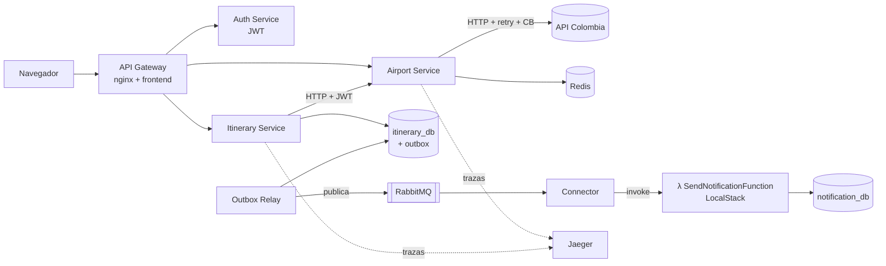
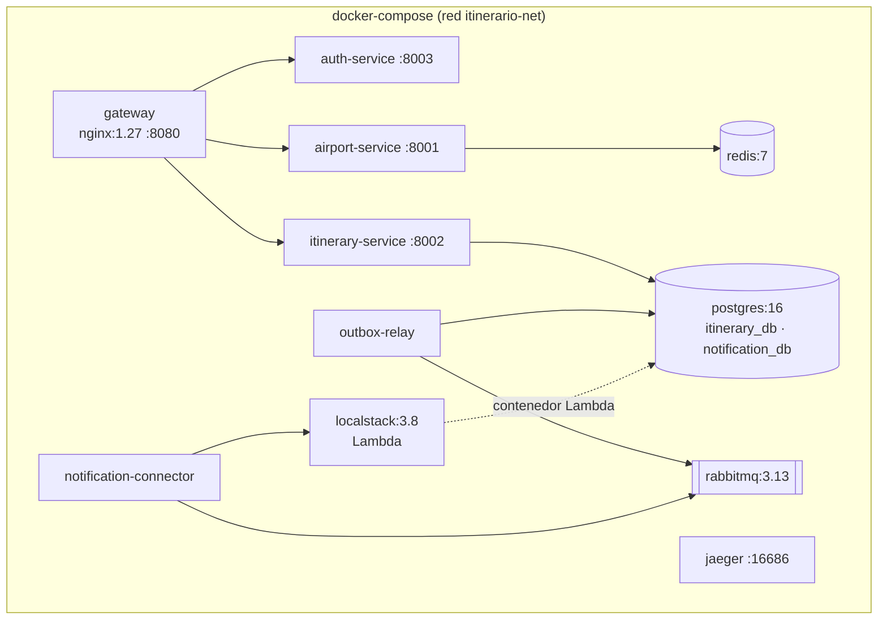
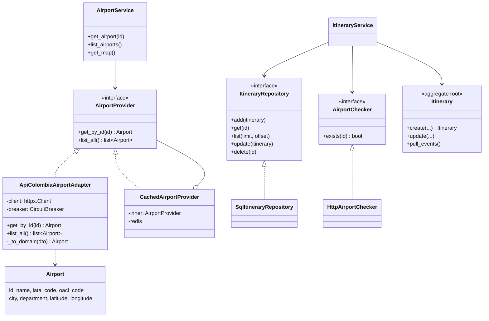
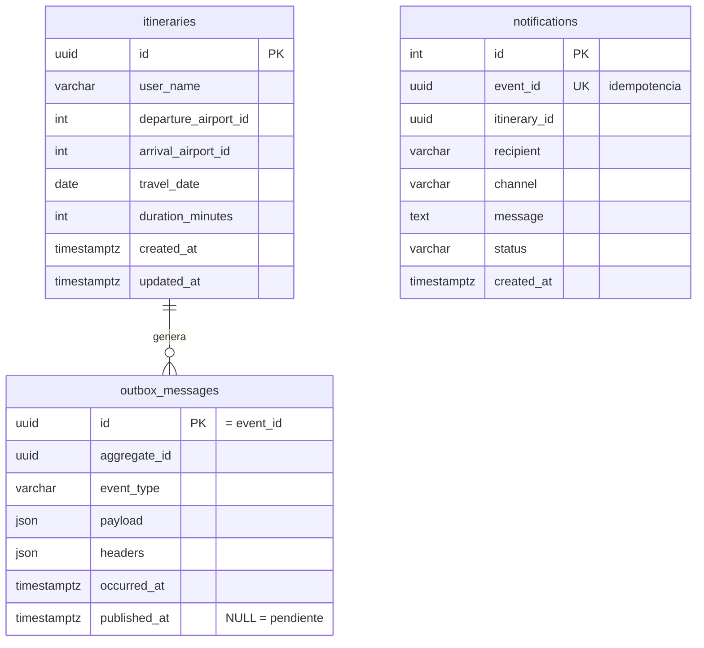
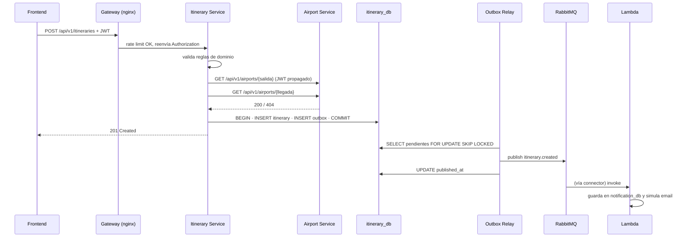

# Sistema de Itinerarios Personales

Proyecto universitario que integra **3 arquitecturas**: microservicios, basada en eventos y serverless. Permite consultar aeropuertos colombianos (API Colombia), verlos en un mapa Plotly y gestionar itinerarios de viaje. Cada itinerario creado se notifica de forma asíncrona.

> El plan detallado está en [docs/planning/](docs/planning/README.md).

## Cómo ejecutarlo

Requisitos: Docker Desktop (con Compose v2).

```bash
docker compose up -d --build
```

| Qué | URL |
|---|---|
| **Aplicación (frontend + API Gateway)** | http://localhost:8080 (usuario `viajero`, clave `viajero123`) |
| Swagger Airport Service | http://localhost:8001/docs |
| Swagger Itinerary Service | http://localhost:8002/docs |
| Swagger Auth Service | http://localhost:8003/docs |
| RabbitMQ (itinerario / itinerario) | http://localhost:15672 |
| Jaeger (trazas distribuidas) | http://localhost:16686 |

> La primera notificación tarda unos segundos: LocalStack descarga la imagen del runtime de Lambda.

Para ver las notificaciones guardadas por la Lambda:

```bash
docker compose exec postgres psql -U notification_user -d notification_db -c "select recipient, status, message from notifications;"
```

Para apagar todo: `docker compose down` (agrega `-v` para borrar también los datos).

### Pruebas

```bash
# Unitarias (en cada servicio)
cd services/airport-service && pip install -r requirements-dev.txt && pytest --cov=app

# E2E con Testcontainers (levanta y destruye todo el sistema)
pip install -r tests/e2e/requirements.txt && pytest tests/e2e -s

# Carga con Locust
pip install locust && locust -f tests/load/locustfile.py --host http://localhost:8080
```

### Demostración de resiliencia (circuit breaker)

1. Abre el mapa en la app para que Redis tenga copia de los aeropuertos.
2. Simula la caída de API Colombia:
   ```bash
   docker compose -f docker-compose.yml -f docker-compose.chaos.yml up -d airport-service
   ```
3. Invalida la caché fresca (Swagger `DELETE /api/v1/airports/cache`) y recarga el mapa varias veces.
4. Revisa los logs: `docker compose logs -f airport-service`. Se ven los reintentos, el circuito pasando a `OPEN` y el fallback a la copia *stale*. Un aeropuerto que nunca se consultó devuelve **503**.
5. Para volver a la normalidad: `docker compose up -d airport-service`.

---

## Arquitectura



| Arquitectura | Dónde | Cómo se demuestra |
|---|---|---|
| **Microservicios** | Airport Service, Itinerary Service (y Auth) | Servicios independientes, cada uno con su Dockerfile, su compose y su BD; se comunican por HTTP |
| **Basada en eventos** | Itinerary Service → RabbitMQ | `ItineraryCreatedEvent` publicado con Transactional Outbox; contrato en [contracts/asyncapi.yaml](contracts/asyncapi.yaml) |
| **Serverless** | `SendNotificationFunction` | AWS Lambda en LocalStack que solo se ejecuta al llegar un evento |

### Arquitectura hexagonal (en cada servicio)

```
app/
├── domain/          # Modelo y reglas de negocio. Python puro, sin frameworks
├── application/     # Casos de uso + PUERTOS (interfaces ABC)
├── infrastructure/  # ADAPTERS: API Colombia, Redis, SQLAlchemy, RabbitMQ, OpenTelemetry
└── api/             # Adapter de entrada: rutas FastAPI, schemas Pydantic, errores
```

Las dependencias solo apuntan hacia adentro: `api → application → domain ← infrastructure`.

### Diagrama de componentes / despliegue (docker-compose)



### Diagrama de clases (patrón Adapter + puertos)



### Diagrama relacional



`itineraries` y `outbox_messages` viven en **itinerary_db**. `notifications` vive en **notification_db**. Cada servicio tiene su base y su usuario, y las migraciones se hacen con **Alembic**.

### Diagrama de secuencia (crear itinerario)



---

## DDD: contextos delimitados y lenguaje ubicuo

| Contexto | Servicio | Responsabilidad | Relación |
|---|---|---|---|
| **Catálogo Aeroportuario** | airport-service | Aeropuertos en nuestro propio modelo | *Anti-Corruption Layer* (Adapter) frente a API Colombia |
| **Planificación de Viajes** (core) | itinerary-service | Ciclo de vida del itinerario | Cliente del Catálogo; publica eventos |
| **Notificaciones** | send-notification (Lambda) | Avisar al viajero y guardar el historial | Consume el *Published Language* (AsyncAPI) |
| **Identidad** (genérico) | auth-service | Emitir JWT | Los demás se conforman a su token |

| Término | Significado |
|---|---|
| Aeropuerto | Infraestructura aérea colombiana con id, nombre, códigos IATA/OACI, ciudad, departamento y coordenadas |
| Itinerario | Plan de viaje de un usuario entre un aeropuerto de salida y uno de llegada, en una fecha y con una duración en minutos |
| Aeropuerto de salida / llegada | Referencia (ID) a un aeropuerto que debe existir en el Catálogo |
| Duración | Minutos del viaje, siempre mayor a 0 |
| Evento ItineraryCreated | Hecho de negocio: se creó un itinerario |
| Outbox | Buzón de salida con los eventos pendientes de publicar |
| Notificación | Aviso enviado al viajero (correo simulado) |

**Decisión sobre el Agregado Aeropuerto:** en el contexto de Planificación, el aeropuerto es una **referencia por valor (solo su ID)** y no un agregado completo. Su dueño es el Catálogo Aeroportuario. Copiarlo entero duplicaría la fuente de verdad y acoplaría los contextos. Por eso, antes de guardar, el Itinerary Service pregunta por HTTP si el aeropuerto existe.

**Eventos de dominio vs. de integración**

| | De dominio | De integración |
|---|---|---|
| Ejemplo | `ItineraryCreated` ([events.py](services/itinerary-service/app/domain/events.py)) | `ItineraryCreatedEvent` JSON ([integration_events.py](services/itinerary-service/app/infrastructure/integration_events.py)) |
| Alcance | Dentro del servicio, en memoria | Entre servicios, por RabbitMQ |
| Contrato | Libre, puede cambiar | Versionado (`event_version`) y documentado en AsyncAPI |

---

## Patrón Adapter

- **Puerto:** `AirportProvider` ([ports.py](services/airport-service/app/application/ports.py)) es la interfaz que usa el caso de uso.
- **Adapter:** `ApiColombiaAirportAdapter` ([api_colombia_adapter.py](services/airport-service/app/infrastructure/api_colombia_adapter.py)) recibe la respuesta externa (`iataCode`, `deparmentId`, objetos anidados) en un DTO Pydantic y la traduce al modelo de dominio `Airport`. **API Colombia entrega la latitud y la longitud invertidas, y el adapter lo corrige.**
- **Decorador** `CachedAirportProvider`: implementa el mismo puerto y añade la caché Redis.
- **Plotly:** el caso de uso transforma los aeropuertos a `{data, layout}`. El frontend nunca ve el formato de API Colombia.

**Resiliencia:** timeout de 3 s, 3 reintentos con backoff exponencial y jitter (tenacity) y un circuit breaker propio ([circuit_breaker.py](services/airport-service/app/infrastructure/circuit_breaker.py)). Si todo falla, se usa la copia *stale* de Redis como fallback, y si no la hay, se responde 503 con `Retry-After`.

## Flujo asíncrono de notificaciones

1. El Itinerary Service guarda el itinerario **y** una fila en `outbox_messages` en la **misma transacción**.
2. `outbox-relay` lee las filas pendientes y las publica en el exchange `itinerary.events` (routing key `itinerary.created`) con *publisher confirms*. Luego marca `published_at`.
3. `notification-connector` consume la cola `notifications.itinerary-created` e invoca la Lambda `SendNotificationFunction` en LocalStack. Hace el papel del *event source mapping* de AWS.
4. La Lambda guarda la notificación en `notification_db` y simula el correo. Si falla, el mensaje va a la **Dead Letter Queue** `notifications.dead-letter`.

## Double Write Problem (Transactional Outbox)

Guardar en la BD y publicar en el broker son dos escrituras en sistemas distintos, y si una falla quedan inconsistentes. Así se resuelve:

- El itinerario y su evento se guardan en **una sola transacción** ([sql_repository.py](services/itinerary-service/app/infrastructure/sql_repository.py)): o se guardan los dos, o ninguno.
- El relay publica después ([outbox_relay.py](services/itinerary-service/app/infrastructure/outbox_relay.py)). Usa `FOR UPDATE SKIP LOCKED`, así que admite varias réplicas.
- La entrega es **at-least-once**. Por eso el consumidor es **idempotente**: `event_id` es `UNIQUE` y la inserción usa `ON CONFLICT DO NOTHING`.

## Observabilidad

- Logs JSON en todos los servicios con `trace_id` y `span_id` (correlation ID).
- Trazas OpenTelemetry → Jaeger. Una petición de creación muestra los spans de itinerary-service y airport-service. El `traceparent` también viaja en los headers del mensaje AMQP.

## DevOps

- **Ramas:** `main` (entregas), `develop` (integración), `feature/ITIN-<n>-<desc>`. Todo cambio entra por Pull Request ([plantilla](.github/pull_request_template.md)).
- **CI** ([ci.yml](.github/workflows/ci.yml)): pruebas y cobertura por servicio, SonarQube y build de imágenes.
- **CD de ejemplo** ([cd.yml](.github/workflows/cd.yml)): publica las imágenes en GHCR, levanta el sistema y ejecuta un smoke test.
- **SonarQube:** `docker compose --profile quality up -d sonarqube` → http://localhost:9000 ([sonar-project.properties](sonar-project.properties)).
- **Docker:** un `docker-compose.yml` por servicio (`services/*/`, `functions/`, `gateway/`), y el de la raíz los reutiliza con `extends`.

## Evidencias

Guardar en `docs/evidence/`: el mapa, la creación de un itinerario con su notificación en BD, Swagger, una traza en Jaeger, el circuit breaker abierto, el reporte de Locust, el dashboard de Sonar y el pipeline en verde.

## Autoevaluación

| Nivel | Criterio | Estado | Dónde |
|---|---|---|---|
| 1 | Patrón Adapter | ✅ | `airport-service/app/infrastructure/api_colombia_adapter.py` |
| 1 | Arquitectura hexagonal | ✅ | `domain / application / infrastructure / api` en cada servicio |
| 1 | DDD básico | ✅ | Sección DDD de este README |
| 1 | CRUD con validación HTTP de aeropuertos | ✅ | `itinerary-service` |
| 1 | BD relacional + migraciones Alembic | ✅ | `migrations/` en itinerary y send-notification |
| 1 | Swagger | ✅ | `/docs` en cada servicio |
| 1 | Manejo de errores | ✅ | `api/errors.py` (formato `{status,title,detail}`) |
| 1 | Logs JSON con trace_id/span_id | ✅ | `infrastructure/observability.py` |
| 1 | Frontend Plotly | ✅ | `frontend/` |
| 1 | Docker + compose | ✅ | |
| 2 | Circuit breaker, retry con backoff, caché Redis | ✅ | airport-service |
| 2 | API Gateway (ruteo, rate limit, JWT) | ✅ | `gateway/nginx.conf` + validación JWT en servicios |
| 2 | Broker + notificaciones + AsyncAPI | ✅ | RabbitMQ, Lambda, `contracts/asyncapi.yaml` |
| 2 | Trazas distribuidas | ✅ | Jaeger |
| 2 | E2E Testcontainers | ✅ | `tests/e2e` |
| 2 | Demostración de resiliencia | ✅ | `docker-compose.chaos.yml` |
| 3 | Transactional Outbox + consistencia | ✅ | itinerary-service + idempotencia en la Lambda |
| 3 | CI/CD | ✅ | `.github/workflows` |
| 3 | API versioning + paginación | ✅ | `/api/v1`, `limit/offset` |
| 3 | gRPC, mTLS, Vault, Chaos Mesh, Kubernetes, Pact, alertas | ❌ | Fuera de alcance (se priorizó la simplicidad) |
