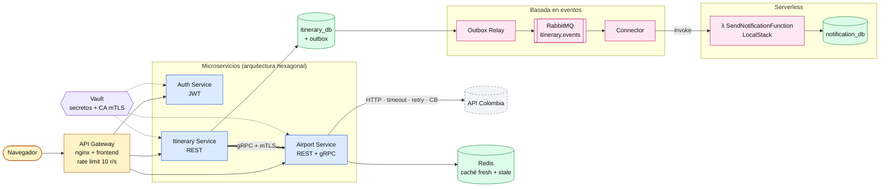
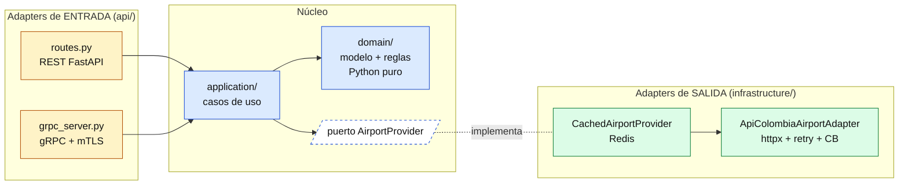
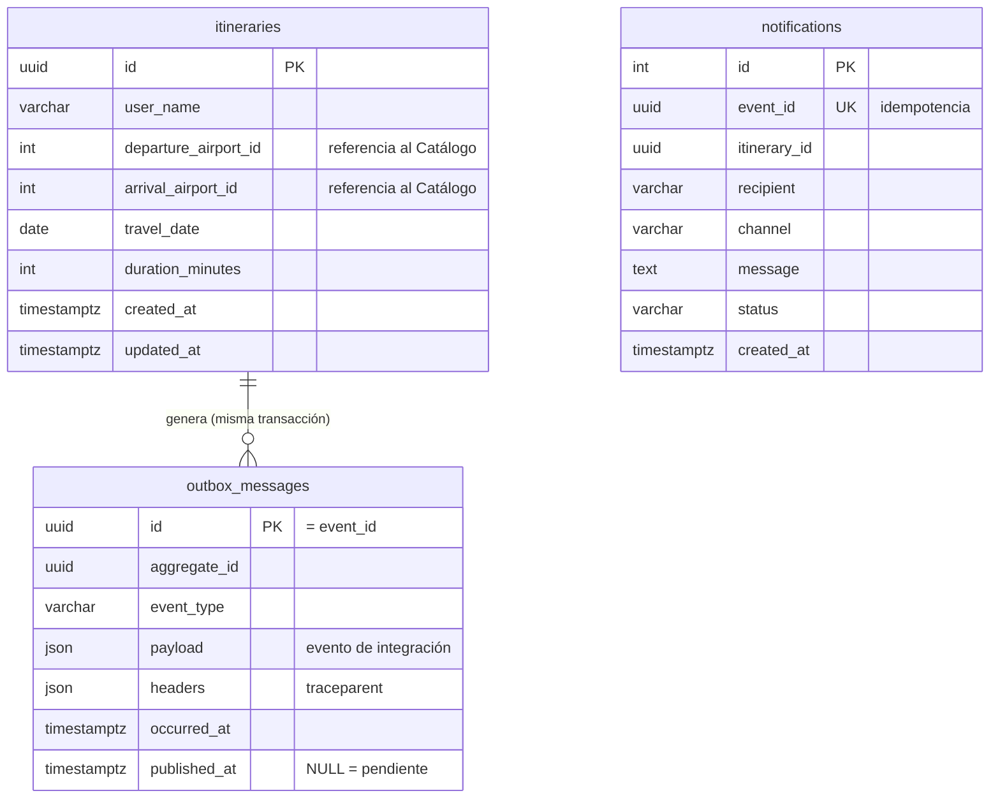
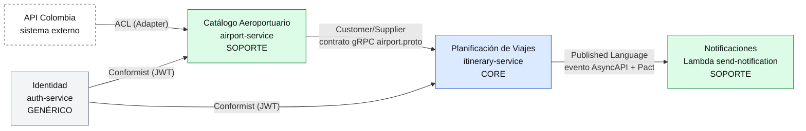
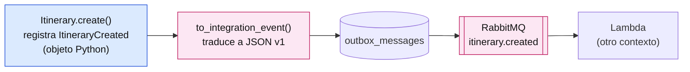
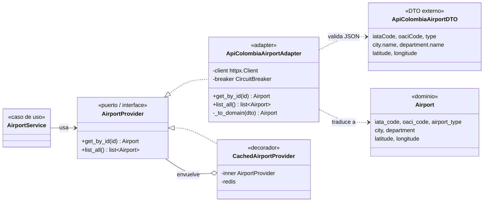
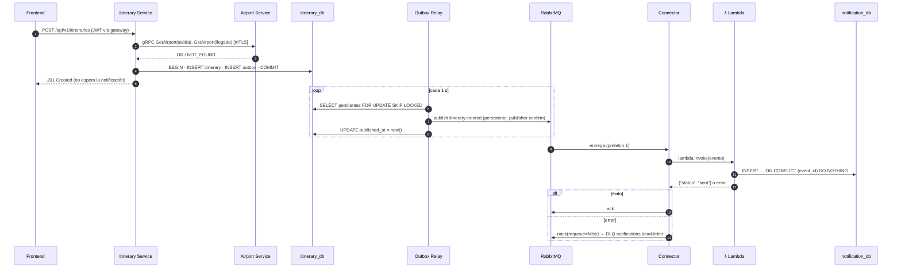

# Sistema de Itinerarios Personales

Proyecto universitario que integra **tres estilos de arquitectura**: microservicios, arquitectura basada en eventos y serverless. El sistema permite:
- consultar los aeropuertos colombianos (API Colombia) y verlos en un mapa Plotly;
- gestionar itinerarios de viaje;
- recibir una notificación asíncrona cada vez que se crea un itinerario.

**Equipo:** Elizabeth Pérez González y María Fernanda Ceballos. El reparto está en [docs/gestion/jira.md](docs/gestion/jira.md).

| Documento | Contenido |
|---|---|
| [Documento de arquitectura](docs/arquitectura/) | Arquitecturas, decisiones y justificación; vistas y diagramas (formato del documento de ejemplo) |
| [Ciclo DevOps](docs/devops/ciclo-devops.md) | Qué se hizo en cada fase: planear, codificar, construir, probar, liberar, desplegar, operar, monitorear |
| [Informe de pruebas](docs/pruebas/informe-de-pruebas.md) | Pytest, eventos, Pact, Selenium, Locust, caos: qué se hizo, cómo y qué arrojó (rama `pruebas`) |
| [Gestión en Jira](docs/gestion/jira.md) | Flujo de estados, reparto entre las 2 integrantes, sincronización por API |
| [Kubernetes + Chaos Mesh](k8s/README.md) | Despliegue en clúster y experimentos de caos |
| [Planning inicial](docs/planning/README.md) | Plan con el que arrancó el proyecto |

---

## 1. Cómo ejecutarlo

Requisito: Docker Desktop (Compose v2).

```bash
docker compose up -d --build
# Si el puerto 5432 ya está ocupado en tu equipo:
#   crea un archivo .env con POSTGRES_PORT=5434
```

| Qué | URL |
|---|---|
| **Aplicación (frontend + API Gateway)** | http://localhost:8080 (usuario `viajero`, clave `viajero123`) |
| Swagger: Airport / Itinerary / Auth | http://localhost:8001/docs · :8002/docs · :8003/docs |
| RabbitMQ (itinerario / itinerario) | http://localhost:15672 |
| Jaeger (trazas distribuidas) | http://localhost:16686 |
| Vault (token `root`) | http://localhost:8200 |
| Prometheus (alertas en `/alerts`) | http://localhost:9090 |
| Alertmanager | http://localhost:9093 |
| Grafana (dashboard "Itinerarios") | http://localhost:3000 |

- La primera notificación tarda unos segundos, porque LocalStack descarga la imagen del runtime de Lambda.
- Para ver las notificaciones guardadas: `docker compose exec postgres psql -U notification_user -d notification_db -c "select recipient, status from notifications;"`
- Para ver las alertas recibidas: `docker compose logs -f alert-receiver`
- Para apagar todo: `docker compose down` (con `-v` también se borran los datos).

### Pruebas

| Tipo | Herramienta | Comando | Resultado |
|---|---|---|---|
| Unitarias + funcionales + eventos | Pytest | `cd services/<servicio> && pip install -r requirements-dev.txt && pytest --cov=app` | 83 pruebas ✅ (cobertura 82–86 %) |
| Eventos con broker real | Pytest + Testcontainers | `pytest -m integration` (itinerary-service) | 3 ✅ (incluye la DLQ) |
| Contrato del evento | Pact | consumidor: `functions/send-notification`; proveedor: `itinerary-service` | ✅, y detecta los cambios incompatibles |
| Automatización web | Selenium | `docker compose --profile tests up -d selenium && pytest tests/web` | 9/9 ✅ |
| Carga y estrés | Locust | `locust -f tests/load/locustfile.py --host http://localhost:8080` | 0 errores, 0 respuestas 5xx |
| E2E (sistema completo) | Testcontainers (compose) | `pytest tests/e2e -s` | 1/1 ✅ (incluye la notificación asíncrona) |
| Caos | Chaos Mesh | `kubectl apply -f k8s/chaos/` | 3/3 hipótesis confirmadas |

El detalle de cada prueba (qué se hizo, cómo y qué se obtuvo) está en el [informe de pruebas](docs/pruebas/informe-de-pruebas.md).

---

## 2. Arquitectura



| Arquitectura | Dónde | Por qué | Cómo se demuestra |
|---|---|---|---|
| **Microservicios** | Airport, Itinerary y Auth | Cada contexto de negocio evoluciona, escala y falla por separado | Servicios independientes, cada uno con su Dockerfile, su compose, su BD y su contrato (REST, gRPC) |
| **Hexagonal** (dentro de cada servicio) | `domain / application / infrastructure / api` | El dominio no depende de frameworks, y los adapters se pueden cambiar | Dos adapters intercambiables para el mismo puerto (`GrpcAirportChecker` / `HttpAirportChecker`) |
| **Basada en eventos** | Itinerary → RabbitMQ | Crear un itinerario no debe esperar ni depender de las notificaciones | `ItineraryCreatedEvent` con Transactional Outbox; contrato en [AsyncAPI](contracts/asyncapi.yaml) |
| **Serverless** | `SendNotificationFunction` | Carga esporádica: solo se paga o ejecuta cuando hay eventos | AWS Lambda en LocalStack que solo corre cuando llega un evento |

### Arquitectura hexagonal



Las dependencias **solo apuntan hacia adentro**: `api → application → domain ← infrastructure`. El dominio no importa FastAPI, httpx, Redis, SQLAlchemy ni gRPC.

Los diagramas completos están en [docs/arquitectura/](docs/arquitectura/): contexto, componentes, secuencias, clases, ER, despliegue en Compose y en Kubernetes, CI/CD y amenazas.

### Diagrama relacional



`itineraries` y `outbox_messages` viven en **itinerary_db**, y `notifications` en **notification_db**. Cada base tiene su propio usuario y sus migraciones Alembic. Ningún servicio lee la base de otro.

---

## 3. DDD: contextos delimitados y lenguaje ubicuo

### 3.1 Contextos delimitados (*bounded contexts*)

Un contexto delimitado es una frontera dentro de la cual un modelo y sus palabras tienen **un único significado**. Identificamos cuatro, y cada uno corresponde a un componente desplegable:



| Contexto | Tipo | Servicio | Responsabilidad | Modelo propio | Relación con los demás |
|---|---|---|---|---|---|
| **Planificación de Viajes** | **Core** (el valor del producto) | itinerary-service | Ciclo de vida del itinerario y sus reglas | `Itinerary` (agregado raíz), `ItineraryCreated` | **Cliente** del Catálogo: le pregunta si existen los aeropuertos. **Publica** eventos |
| **Catálogo Aeroportuario** | Soporte | airport-service | Ofrecer los aeropuertos colombianos en NUESTRO modelo, aunque la API externa falle | `Airport` (objeto de valor inmutable) | **ACL** frente a API Colombia. **Proveedor** (*supplier*) del contrato gRPC |
| **Notificaciones** | Soporte | Lambda `SendNotificationFunction` | Avisar al viajero y guardar el historial de avisos | `Notification` (tabla `notifications`) | Consume el **lenguaje publicado** (*Published Language*) del evento, sin conocer el modelo interno de Planificación |
| **Identidad** | Genérico (se compra, no se construye) | auth-service | Autenticar y emitir JWT | Usuario, token | Los demás contextos se **conforman** a su formato de token |

Patrones de relación usados:
- **Anti-Corruption Layer (ACL):** el formato de API Colombia (camelCase, objetos anidados, latitud y longitud invertidas) no entra al dominio. El Adapter lo traduce en la frontera.
- **Customer/Supplier con contrato explícito:** Planificación necesita saber si un aeropuerto existe. El Catálogo lo ofrece en [`contracts/proto/airport.proto`](contracts/proto/airport.proto). El contrato está versionado (`airport.v1`) y de él se genera el código.
- **Published Language:** el evento de integración tiene un esquema público ([AsyncAPI](contracts/asyncapi.yaml)) y un contrato verificado por el consumidor ([Pact](contracts/pacts/)).
- **Separate Ways en los datos:** cada contexto tiene su propia base de datos (database per service). Ningún servicio hace JOIN con datos de otro.

### 3.2 Lenguaje ubicuo

Los mismos términos se usan en las conversaciones, en los documentos **y en el código**:

| Término (negocio) | En el código | Significado y reglas |
|---|---|---|
| **Aeropuerto** | `Airport` | Infraestructura aérea colombiana: id, nombre, códigos IATA/OACI, tipo, ciudad, departamento y coordenadas (que pueden faltar) |
| **Itinerario** | `Itinerary` | Plan de viaje de un usuario entre un aeropuerto de salida y uno de llegada, en una fecha y con una duración |
| **Aeropuerto de salida / llegada** | `departure_airport_id` / `arrival_airport_id` | Referencia al Catálogo. **Deben ser distintos** y **deben existir** |
| **Fecha de viaje** | `travel_date` | No puede estar en el pasado |
| **Duración** | `duration_minutes` | Minutos del viaje, siempre mayor que 0 |
| **Crear itinerario** | `ItineraryService.create()` / `Itinerary.create()` | Caso de uso; valida las reglas y registra el evento |
| **Itinerario creado** | `ItineraryCreated` (dominio) / `itinerary.created` (integración) | Hecho de negocio ya ocurrido (verbo en pasado) |
| **Buzón de salida** | `outbox_messages` | Eventos guardados pendientes de publicar |
| **Notificación** | `notifications` | Aviso enviado al viajero (correo simulado) |
| **Catálogo** | `AirportProvider` (puerto) | Fuente de aeropuertos, sin importar si vienen de la API o de la caché |
| **Copia de respaldo** | `airport:stale:*` | Último dato conocido; se usa si API Colombia falla |

Las invariantes del agregado `Itinerary` (nombre obligatorio de máximo 100 caracteres, aeropuertos distintos y positivos, duración > 0, fecha no pasada) se validan **dentro del agregado** ([models.py](services/itinerary-service/app/domain/models.py)). No se validan en el controlador ni en la base de datos, así que no es posible construir un itinerario inválido.

---

## 4. Decisión sobre el agregado Aeropuerto: referencia de valor o agregado completo

**Pregunta:** dentro del contexto de Planificación, ¿el itinerario debe contener el aeropuerto completo (un agregado `Airport` con todos sus datos), o solo una **referencia** a él?

| Criterio | A) Agregado completo dentro de Planificación | B) Réplica local sincronizada por eventos | **C) Referencia de valor (solo el ID)** ✅ |
|---|---|---|---|
| Fuente de verdad | Dos (Catálogo y Planificación) | Una, más una copia | **Una: el Catálogo** |
| Consistencia | Datos duplicados que se desactualizan | Eventual (depende de la sincronización) | **Siempre la del Catálogo** |
| Acoplamiento | Alto: Planificación conoce el modelo de aeropuerto | Medio | **Bajo: solo un entero** |
| Tamaño del agregado | Grande: transacciones más pesadas | Pequeño | **Pequeño** |
| ¿Quién cambia el aeropuerto? | ¿Ambos? Conflicto | Catálogo | **Solo el Catálogo** |
| Disponibilidad al crear | No depende del Catálogo | No depende del Catálogo | Depende del Catálogo (mitigado, ver abajo) |
| Complejidad | Media | **Alta**: hay que publicar y consumir eventos de aeropuertos | **Baja** |

**Decisión: C, referencia de valor.** El itinerario guarda `departure_airport_id` y `arrival_airport_id`, que son **identificadores que apuntan a otro agregado de otro contexto**. Es la regla de DDD de *referenciar otros agregados por identidad*. Los aeropuertos no los crea ni los modifica Planificación; son datos de referencia de otro contexto (y en última instancia de API Colombia).

**Cómo se garantiza la integridad sin el agregado completo.** Antes de guardar, el caso de uso pregunta al Catálogo por el puerto `AirportChecker.exists(id)`. Por defecto se usa **gRPC con mTLS**: `GetAirport` responde OK o `NOT_FOUND`. Si un aeropuerto no existe, la respuesta es **422**.

**Consecuencia aceptada y cómo se mitiga.** Crear un itinerario depende de que el Catálogo responda. Para que esa dependencia no tumbe la creación:
1. El Catálogo tiene su propia caché Redis, con una copia *stale* de respaldo y circuit breaker. Aunque API Colombia esté caída, sigue respondiendo.
2. Si el Catálogo no responde, el Itinerary Service devuelve **503** con un mensaje claro. **No** guarda un itinerario sin validar.
3. Para mostrar nombres en la interfaz, el frontend consulta el Catálogo. El itinerario no duplica el nombre.

---

## 5. Eventos de dominio vs. eventos de integración

Existen **dos tipos de evento** con propósitos distintos. Mezclarlos es un error común: el modelo interno quedaría expuesto a otros servicios.



| | **Evento de dominio** | **Evento de integración** |
|---|---|---|
| Código | `ItineraryCreated` en [domain/events.py](services/itinerary-service/app/domain/events.py) | `ItineraryCreatedEvent` en [infrastructure/integration_events.py](services/itinerary-service/app/infrastructure/integration_events.py) |
| Capa | Dominio (Python puro) | Infraestructura |
| Quién lo produce | El agregado `Itinerary`, al cumplirse sus reglas | El repositorio, al guardar (traducción del de dominio) |
| Audiencia | El propio contexto de Planificación | **Otros contextos** (Notificaciones), en otro proceso |
| Forma | Objeto inmutable con tipos ricos (`UUID`, `date`, `datetime`) | **JSON** con tipos primitivos (strings ISO 8601) |
| Transporte | En memoria (`pull_events()`) | RabbitMQ (exchange `itinerary.events`), vía Outbox |
| Contrato | Interno: puede cambiar libremente | **Público y versionado**: `event_type`, `event_version: 1`, esquema en [AsyncAPI](contracts/asyncapi.yaml), verificado con **Pact** |
| Metadatos | — | `event_id` (para la idempotencia), `occurred_at`, header `traceparent` (traza distribuida) |
| Si cambia… | Solo se ajusta el traductor | Hay que versionar (`event_version: 2`) y avisar a los consumidores |

**¿Por qué separarlos?** El modelo de dominio puede renombrar campos o cambiar tipos sin romper a nadie, porque el traductor `to_integration_event()` mantiene estable el contrato público. Las pruebas de [test_eventos.py](services/itinerary-service/tests/test_eventos.py) validan que el JSON cumple el esquema AsyncAPI. Las de Pact ([proveedor](services/itinerary-service/tests/test_pact_provider.py) y [consumidor](functions/send-notification/tests/test_pact_consumer.py)) fallan si alguien cambia un campo que la Lambda necesita.

---

## 6. Patrón Adapter implementado

**Problema:** API Colombia tiene **su** formato: camelCase, objetos anidados, campos opcionales y hasta datos erróneos. Si ese formato llegara al dominio, cualquier cambio de la API rompería todo el sistema.

**Solución:** un adapter que implementa el **puerto** que el caso de uso espera y traduce en la frontera.



| Pieza | Archivo | Responsabilidad |
|---|---|---|
| **Puerto** `AirportProvider` | [ports.py](services/airport-service/app/application/ports.py) | Interfaz que conoce el caso de uso |
| **DTO** `ApiColombiaAirportDTO` | [api_colombia_adapter.py](services/airport-service/app/infrastructure/api_colombia_adapter.py) | Refleja **exactamente** el JSON externo (Pydantic lo valida) |
| **Adapter** `ApiColombiaAirportAdapter` | mismo archivo | Llama a la API con timeout, retry y circuit breaker, y traduce con `_to_domain()` |
| **Decorador** `CachedAirportProvider` | [redis_cache.py](services/airport-service/app/infrastructure/redis_cache.py) | Implementa el mismo puerto y agrega la caché. El caso de uso no lo nota |
| **Modelo** `Airport` | [models.py](services/airport-service/app/domain/models.py) | Nuestro modelo, con nuestros nombres |

Traducción que hace `_to_domain()`:

| API Colombia | Dominio | Corrección aplicada |
|---|---|---|
| `iataCode` / `oaciCode` | `iata_code` / `oaci_code` | Nombres del lenguaje ubicuo; `None` → `""` |
| `type` | `airport_type` | — |
| `city.name` / `department.name` | `city` / `department` | Aplana los objetos anidados |
| `latitude` / `longitude` | `latitude` / `longitude` | **Vienen invertidas** en la API: si `abs(lat) > 20 >= abs(lon)` se intercambian. `0,0` se trata como "sin coordenadas" (`None`) |

El frontend tampoco ve nunca el formato de API Colombia: el caso de uso devuelve la figura Plotly `{data, layout}` ya armada.

**Segundo ejemplo del patrón (nivel 3):** el puerto `AirportChecker` del Itinerary Service tiene **dos adapters intercambiables**, `GrpcAirportChecker` (gRPC + mTLS, por defecto) y `HttpAirportChecker` (REST + JWT). Se elige con `AIRPORT_TRANSPORT=grpc|http` sin tocar el dominio.

**Resiliencia dentro del adapter:**
- timeout de 3 s;
- 3 intentos con backoff exponencial y jitter;
- circuit breaker propio ([circuit_breaker.py](services/airport-service/app/infrastructure/circuit_breaker.py)) que envuelve los reintentos.

Si todo falla, el decorador sirve la copia *stale* de Redis, y si no la hay, el servicio responde 503 con `Retry-After`.

---

## 7. Flujo asíncrono de notificaciones



**Topología en RabbitMQ** (declarada por [`declare_topology`](services/itinerary-service/app/infrastructure/messaging.py), igual en el productor y en el consumidor):

| Elemento | Nombre | Tipo / propiedad |
|---|---|---|
| Exchange | `itinerary.events` | `topic`, durable |
| Routing key | `itinerary.created` | permite agregar otros eventos (`itinerary.updated`…) sin cambiar a nadie |
| Cola del consumidor | `notifications.itinerary-created` | durable, con `x-dead-letter-exchange` |
| Dead letter exchange | `itinerary.events.dlx` | recibe lo rechazado |
| DLQ | `notifications.dead-letter` | mensajes que fallaron, intactos, para reprocesarlos. **Alerta** `MensajesEnDeadLetterQueue` |

**Garantías:**

| Situación | Qué pasa |
|---|---|
| RabbitMQ caído al crear un itinerario | El itinerario **se crea igual** (201). El evento espera en el outbox y se publica cuando vuelve el broker. Verificado con Chaos Mesh: 5 de 5 eventos publicados tras la partición |
| El relay se cae después de publicar y antes de marcar | El evento se vuelve a publicar (at-least-once). La Lambda lo ignora porque el `event_id` ya existe (idempotencia) |
| La Lambda falla | `nack` → DLQ, y Prometheus dispara la alerta |
| Trazabilidad | El header `traceparent` viaja en el mensaje: la traza de Jaeger conecta la petición HTTP con la publicación |

¿Por qué un *connector* y no una Lambda suscrita directamente? En AWS, una Lambda se suscribe a una cola con un *event source mapping*. LocalStack gratuito no lo ofrece para RabbitMQ, así que [connector.py](functions/notification-connector/connector.py) cumple ese papel. No tiene lógica de negocio.

---

## 8. Double Write Problem: cómo se resolvió (nivel 3)

**El problema.** Al crear un itinerario hay que hacer **dos escrituras en dos sistemas distintos**: guardarlo en PostgreSQL y publicar el evento en RabbitMQ. No existe una transacción común a ambos:

| Orden | Si falla la segunda escritura… |
|---|---|
| 1. Guardar en BD → 2. publicar | Itinerario guardado, **evento perdido**: el viajero nunca recibe la notificación |
| 1. Publicar → 2. guardar en BD | Notificación de un itinerario **que no existe** |
| Publicar dentro de la transacción de BD | El broker recibe el evento, luego la BD hace rollback: igual de inconsistente |

**Alternativas evaluadas:**

| Alternativa | Por qué no / por qué sí |
|---|---|
| Two-Phase Commit (XA) | RabbitMQ no lo soporta bien; bloqueante y frágil |
| CDC (Debezium leyendo el WAL) | Correcto, pero agrega Kafka Connect y Debezium: demasiada infraestructura para el proyecto |
| **Transactional Outbox + relay** ✅ | Solo usa la BD que ya existe. Simple, probable y explicable |

**La solución implementada:**
1. **Una sola transacción local** ([sql_repository.py](services/itinerary-service/app/infrastructure/sql_repository.py)). El `INSERT` del itinerario y el `INSERT` del evento en `outbox_messages` van en el mismo `session.begin()`: se guardan los dos o ninguno.
2. **Relay separado** ([outbox_relay.py](services/itinerary-service/app/infrastructure/outbox_relay.py)):
   - lee los pendientes con `FOR UPDATE SKIP LOCKED`, así que admite varias réplicas sin publicar dos veces lo mismo;
   - publica con *publisher confirms* y mensajes persistentes;
   - solo entonces marca `published_at`.
3. **Consumidor idempotente:** la entrega es *at-least-once*, así que la Lambda usa `event_id UNIQUE` + `ON CONFLICT DO NOTHING`. Un duplicado no genera una segunda notificación.

**Evidencia:**

| Prueba | Archivo / experimento | Resultado |
|---|---|---|
| Si falla guardar el evento, tampoco se guarda el itinerario | `test_outbox_si_falla_el_guardado_del_evento_tampoco_se_guarda_el_itinerario` | ✅ rollback de ambos |
| Si el broker falla, el evento sigue pendiente y luego se publica | `test_relay_si_el_broker_falla_el_evento_sigue_pendiente` | ✅ |
| Evento duplicado → una sola notificación | `test_es_idempotente_ante_eventos_duplicados` (Lambda) | ✅ |
| Partición de red relay ↔ RabbitMQ en Kubernetes | Chaos Mesh `03-particion-rabbitmq.yaml` | ✅ 5 creados durante la partición, 5 publicados después, 0 perdidos |

---

## 9. Nivel 3: lo implementado tras la revisión

| Ítem | Implementación | Dónde | Verificado |
|---|---|---|---|
| **gRPC** | `GetAirport` en [airport.proto](contracts/proto/airport.proto). Servidor en airport-service (puerto 50051), cliente en itinerary-service | `app/api/grpc_server.py`, `app/infrastructure/airport_grpc_client.py` | Pruebas unitarias + sistema en Compose y Kubernetes |
| **mTLS** | El servidor exige certificado al cliente (`require_client_auth=True`) y autoriza por CN (`itinerary-service`) | `grpc_server.py` | Pruebas: el CN permitido entra, otro CN → `PERMISSION_DENIED`, sin certificado → no conecta |
| **Vault** | KV con los secretos (JWT, BD, RabbitMQ). PKI como CA interna que emite los certificados mTLS al arrancar. Una política de mínimo privilegio por servicio | [infra/vault/init.sh](infra/vault/init.sh), `app/infrastructure/vault.py` | El token del Airport Service recibe **403** al leer los secretos del Itinerary Service |
| **Alertas** | Métricas Prometheus en cada servicio, 6 reglas ([alerts.yml](infra/monitoring/alerts.yml)), Alertmanager → receptor del equipo, dashboard en Grafana | `infra/monitoring/` | `CircuitBreakerAbierto` y `MensajesEnDeadLetterQueue` disparadas y recibidas |
| **Pact** | Contrato de mensaje: la Lambda (consumidor) define lo que necesita y el Itinerary Service (proveedor) lo verifica | `contracts/pacts/`, `test_pact_*.py` | ✅, y una prueba demuestra que renombrar `user_name` rompe el contrato |
| **Kubernetes** | Deployments con 2 réplicas, HPA, readiness/liveness, Job de migraciones, StatefulSet de Postgres, NodePort del gateway | [k8s/](k8s/README.md) | Desplegado en k3s: login, mapa y CRUD funcionando |
| **Chaos Mesh** | PodChaos (matar un pod), NetworkChaos (latencia hacia API Colombia), NetworkChaos (partición relay ↔ broker) | [k8s/chaos/](k8s/chaos/) | 3/3 hipótesis confirmadas, más 2 hallazgos corregidos o documentados |

## 10. Observabilidad

- **Logs JSON** en todos los servicios, con `trace_id` y `span_id` (correlation ID).
- **Trazas OpenTelemetry → Jaeger** (HTTP **y gRPC**). Una creación muestra los spans de itinerary-service y airport-service, y el `traceparent` viaja también en el mensaje AMQP.
- **Métricas → Prometheus → Grafana:**
  - peticiones y latencia p95 por servicio;
  - estado del circuit breaker;
  - uso de la caché (hit/miss/stale);
  - eventos pendientes en el outbox;
  - mensajes en la DLQ;
  - llamadas gRPC por código.
- **Alertas:** `ServicioCaido`, `CircuitBreakerAbierto`, `MensajesEnDeadLetterQueue`, `OutboxAtascado`, `TasaDeErrores5xx` y `LatenciaAlta`.

## 11. DevOps (resumen)

Ver el detalle por fases en [docs/devops/ciclo-devops.md](docs/devops/ciclo-devops.md).

- **Planear:** Jira con el flujo To Do → In Design → In Review → Approved → Done, sincronizado por API ([jira/](jira/)).
- **Codificar:**
  - Ramas `main`, `develop`, `feature/ITIN-<n>-<desc>` y `pruebas`.
  - Todo cambio entra por Pull Request ([plantilla](.github/pull_request_template.md)).
- **Construir y probar (CI)** ([ci.yml](.github/workflows/ci.yml)):
  - pruebas y cobertura por servicio;
  - Pact (consumidor → proveedor);
  - validación de los manifiestos de Kubernetes;
  - SonarQube;
  - build de imágenes.
- **Liberar y desplegar (CD)** ([cd.yml](.github/workflows/cd.yml)): publica las imágenes en GHCR, despliega y ejecuta un smoke test.
- **Operar y monitorear:** Prometheus, Grafana, Alertmanager y Jaeger. Chaos Mesh para validar la resiliencia.

## 12. Autoevaluación

| Nivel | Criterio | Estado | Dónde |
|---|---|---|---|
| 1 | Patrón Adapter | ✅ | `airport-service/app/infrastructure/api_colombia_adapter.py` · sección 6 |
| 1 | Arquitectura hexagonal | ✅ | `domain / application / infrastructure / api` en cada servicio |
| 1 | DDD (contextos, lenguaje ubicuo, agregado) | ✅ | Secciones 3 y 4 |
| 1 | CRUD con validación de aeropuertos | ✅ | `itinerary-service` (gRPC o HTTP) |
| 1 | BD relacional + migraciones Alembic | ✅ | `migrations/` en itinerary y send-notification |
| 1 | Swagger | ✅ | `/docs` en cada servicio |
| 1 | Manejo de errores | ✅ | `api/errors.py` (formato `{status,title,detail}`) |
| 1 | Logs JSON con trace_id/span_id | ✅ | `infrastructure/observability.py` |
| 1 | Frontend Plotly | ✅ | `frontend/` |
| 1 | Docker + compose por servicio | ✅ | `services/*/docker-compose.yml` + raíz |
| 2 | Circuit breaker, retry con backoff, caché Redis | ✅ | airport-service |
| 2 | API Gateway (ruteo, rate limit, JWT) | ✅ | `gateway/` + validación JWT en los servicios |
| 2 | Broker + notificaciones + AsyncAPI | ✅ | RabbitMQ, Lambda, `contracts/asyncapi.yaml` · sección 7 |
| 2 | Trazas distribuidas | ✅ | Jaeger (HTTP + gRPC + AMQP) |
| 2 | Pruebas E2E, web y de carga | ✅ | `tests/e2e`, `tests/web`, `tests/load` |
| 2 | Demostración de resiliencia | ✅ | `docker-compose.chaos.yml` + Chaos Mesh |
| 3 | Transactional Outbox + consistencia | ✅ | Sección 8 |
| 3 | CI/CD | ✅ | `.github/workflows` |
| 3 | API versioning + paginación | ✅ | `/api/v1`, `limit/offset`, `airport.v1`, `event_version` |
| 3 | gRPC + mTLS | ✅ | `contracts/proto`, `grpc_server.py` |
| 3 | Vault | ✅ | `infra/vault`, `vault.py` |
| 3 | Alertas | ✅ | `infra/monitoring` |
| 3 | Pact | ✅ | `contracts/pacts` |
| 3 | Kubernetes + Chaos Mesh | ✅ | `k8s/` |
