# Arquitectura del Sistema de Itinerarios

📄 **Documento completo:** [Documento de Arquitectura - Sistema de Itinerarios.docx](Documento%20de%20Arquitectura%20-%20Sistema%20de%20Itinerarios.docx)

Sigue el formato del documento de ejemplo del curso:
- versionamiento y tabla de contenido;
- abreviaturas, introducción, alcance e interesados;
- 22 requerimientos no funcionales (RNF);
- priorización de atributos, tácticas y verificación con los resultados reales de las pruebas;
- lineamientos técnicos;
- vistas lógica, de implementación, integración, despliegue, DevOps y amenazas;
- decisiones descartadas.

Autoras: Elizabeth Pérez González y María Fernanda Ceballos · versión 1.0 · 18/11/2026.

## Diagramas

Las fuentes están en [`diagramas/`](diagramas/) en formato Mermaid (`.mmd`). Los PNG se generan con:

```bash
npx -y @mermaid-js/mermaid-cli@11.4.2 -i diagramas/02-contenedores.mmd -o diagramas/02-contenedores.png \
    -c diagramas/_config.json -b white -w 1600 -s 2
```

Cada tipo de componente tiene su color:

| Color | Tipo |
|---|---|
| 🟦 azul | servicios propios |
| 🟩 verde | datos |
| 🟨 ámbar | mensajería |
| 🟥 rojo | seguridad |
| 🟪 morado | observabilidad |
| 🟧 naranja | serverless / adapters de salida |
| ⬜ gris | sistemas externos |

| # | Diagrama | Vista |
|---|---|---|
| 1 | [Contexto (C4 nivel 1)](#1-contexto) | Lógica |
| 2 | [Componentes de alto nivel (C4 nivel 2)](#2-componentes-de-alto-nivel) | Implementación |
| 3 | [Hexagonal: Airport Service](#3-hexagonal-airport-service) | Implementación detallada |
| 4 | [Hexagonal: Itinerary Service](#4-hexagonal-itinerary-service) | Implementación detallada |
| 5 | [Secuencia de autenticación](#5-autenticación) | Seguridad |
| 6 | [Secuencia crear itinerario](#6-crear-itinerario-síncrono--asíncrono) | Transacción tipo A |
| 7 | [Secuencia de resiliencia](#7-resiliencia) | Fiabilidad |
| 8 | [Clases del dominio](#8-modelo-de-dominio) | Lógica |
| 9 | [Modelo entidad-relación](#9-modelo-entidad-relación) | Datos |
| 10 | [Despliegue Docker Compose](#10-despliegue-docker-compose) | Despliegue |
| 11 | [Despliegue Kubernetes + Chaos Mesh](#11-despliegue-kubernetes) | Despliegue |
| 12 | [Pipeline CI/CD](#12-ciclo-devops) | DevOps |
| 13 | [Mapa de contextos DDD](#13-mapa-de-contextos-ddd) | Lógica |
| 14 | [Vista de amenazas (STRIDE)](#14-vista-de-amenazas) | Seguridad |

### 1. Contexto
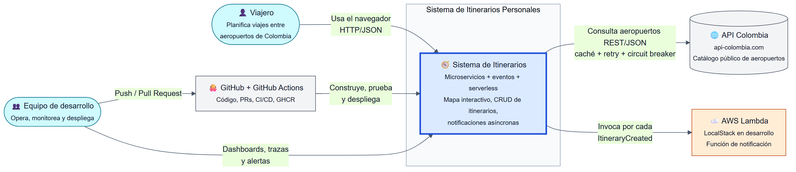

### 2. Componentes de alto nivel
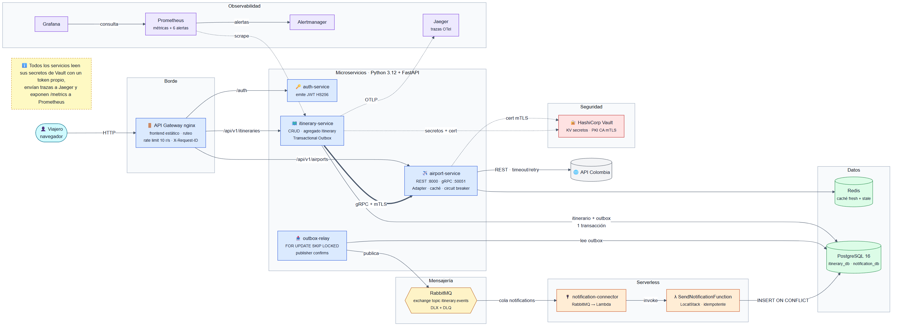

### 3. Hexagonal: Airport Service
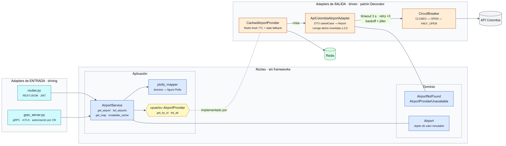

### 4. Hexagonal: Itinerary Service
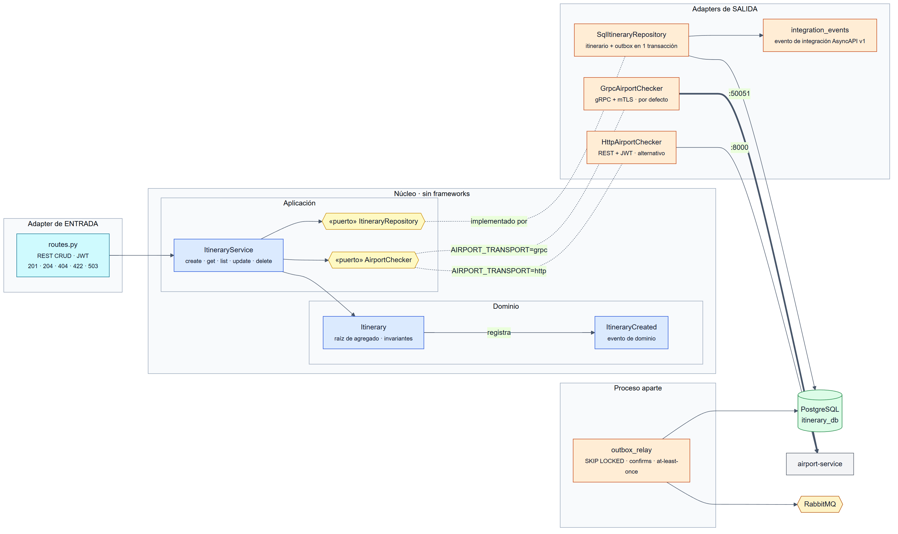

### 5. Autenticación
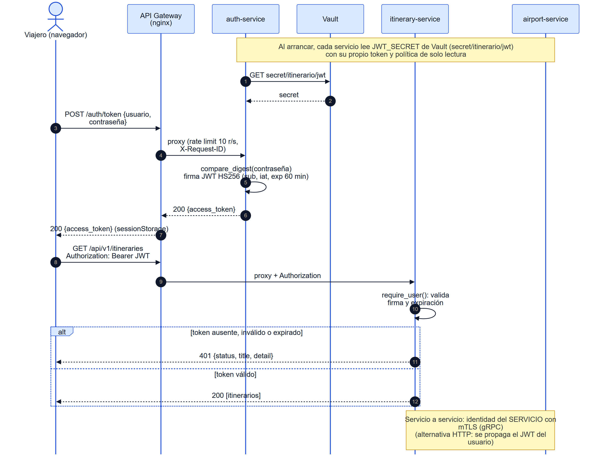

### 6. Crear itinerario (síncrono + asíncrono)
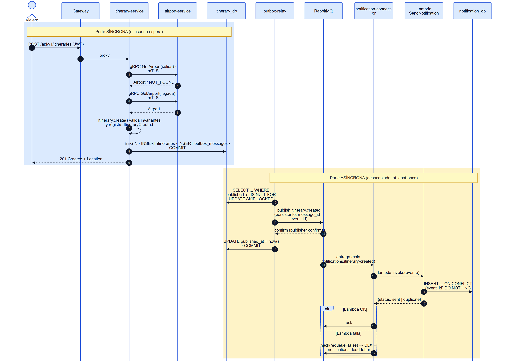

### 7. Resiliencia
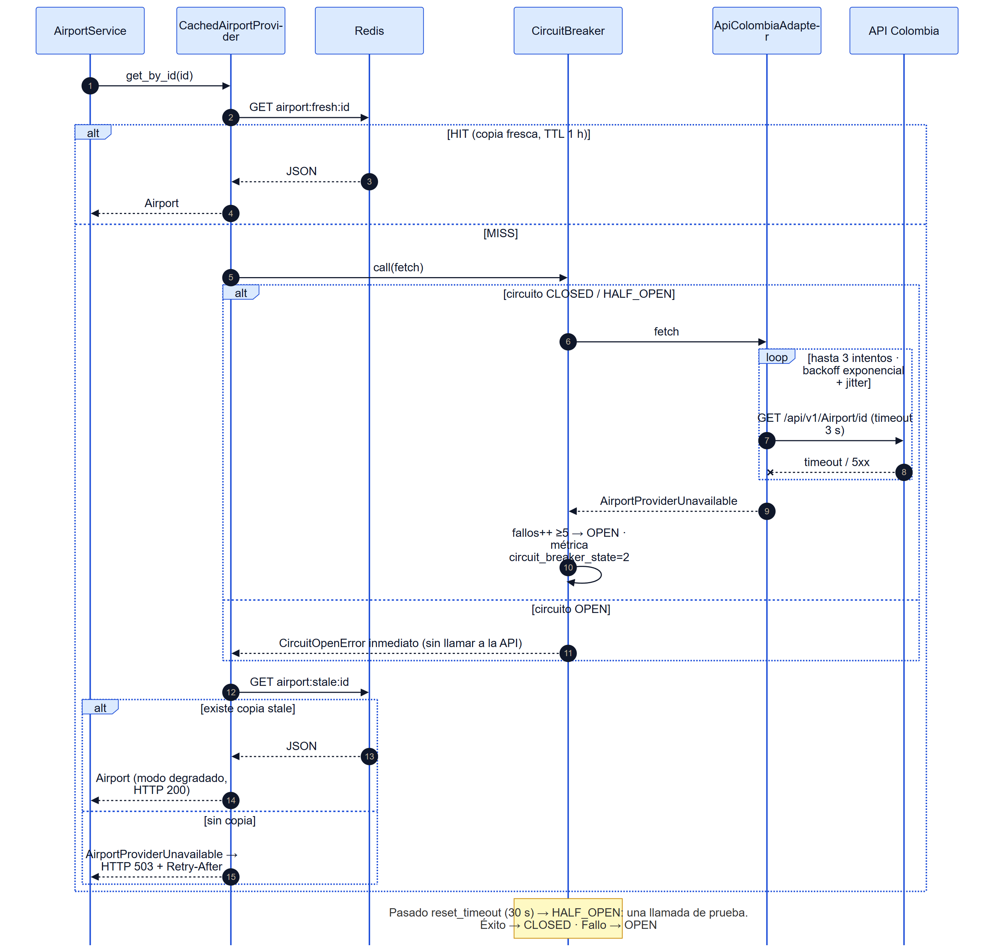

### 8. Modelo de dominio
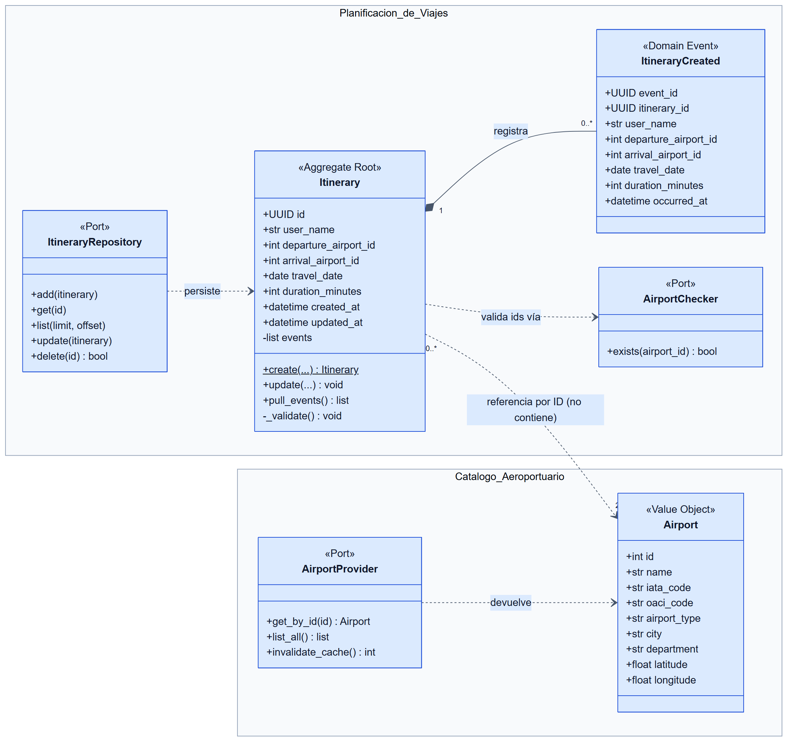

### 9. Modelo entidad-relación
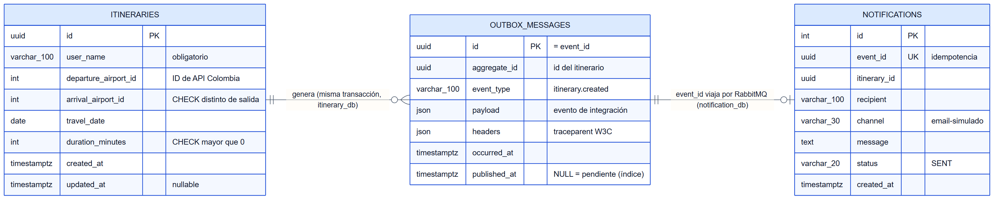

### 10. Despliegue Docker Compose
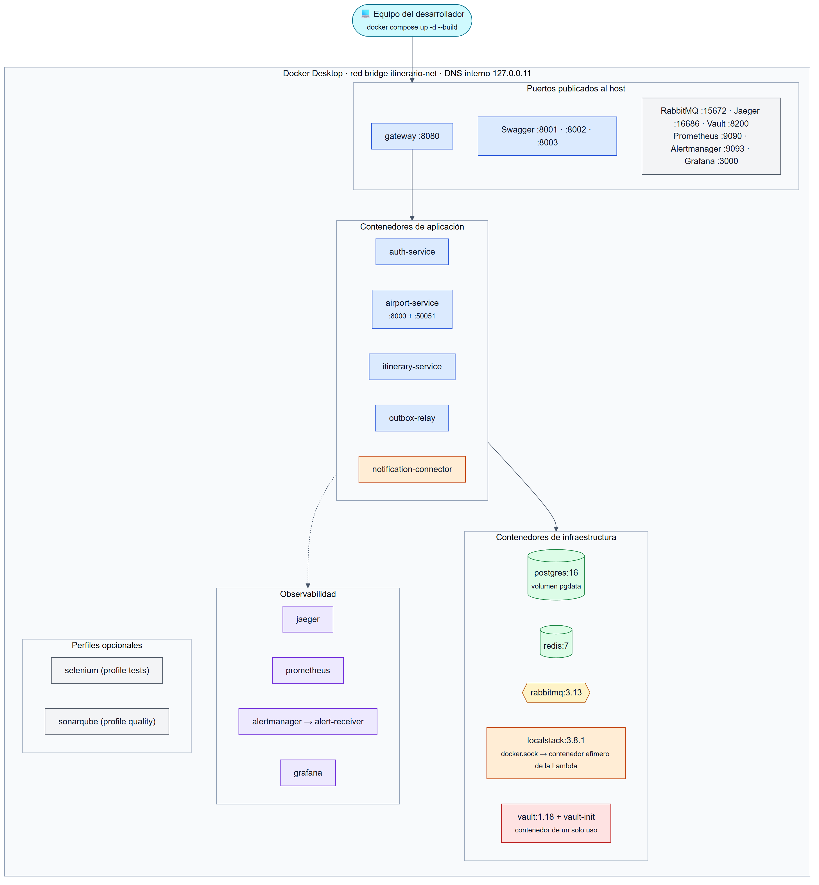

### 11. Despliegue Kubernetes
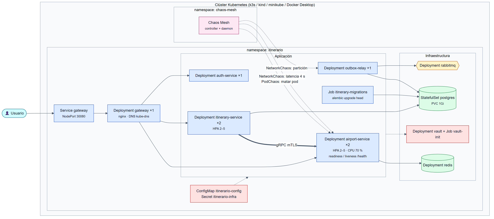

### 12. Ciclo DevOps
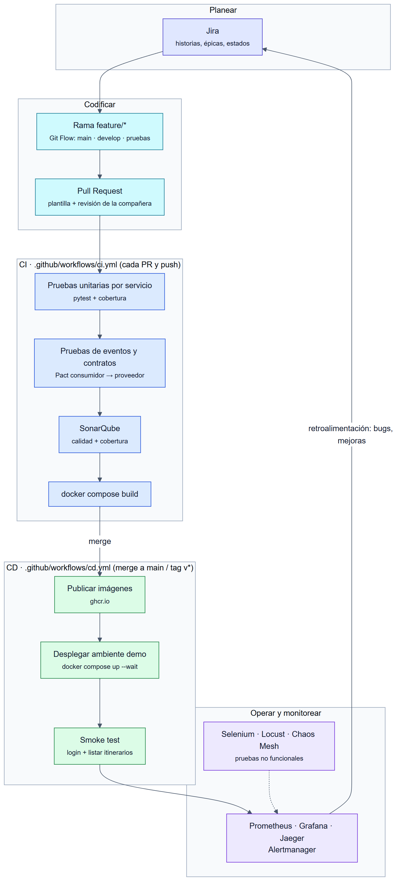

### 13. Mapa de contextos DDD
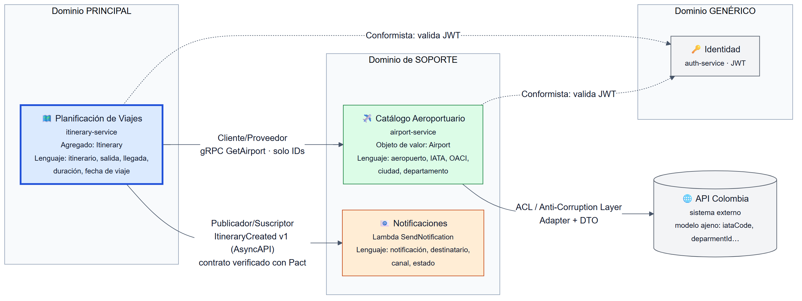

### 14. Vista de amenazas
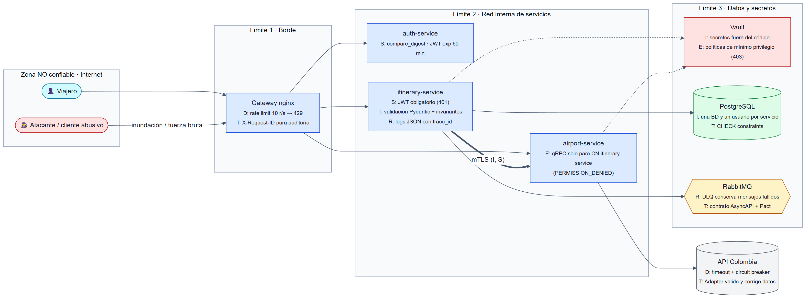
