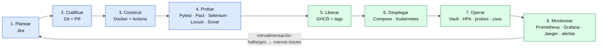
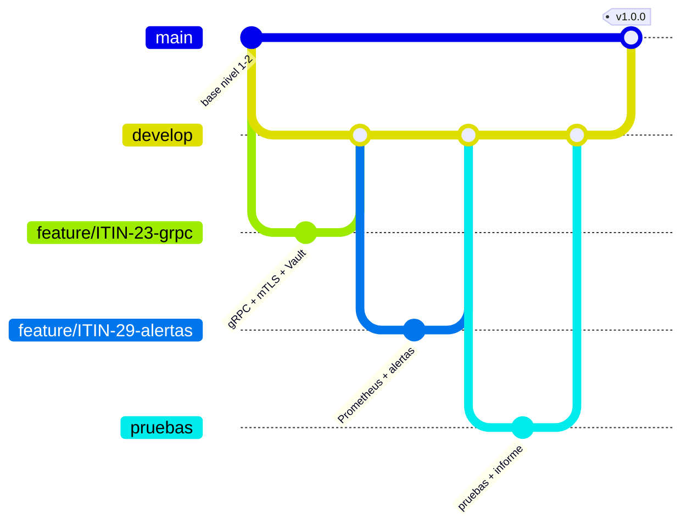
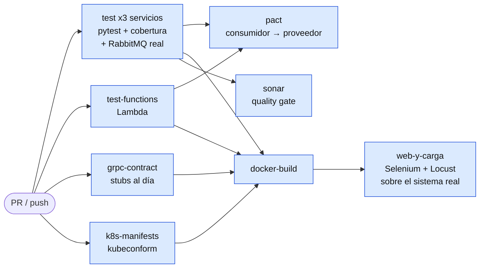

# Ciclo DevOps del proyecto

**Equipo:** Elizabeth Pérez González y María Fernanda Ceballos.

Este documento reúne **todo lo que se hizo en el proyecto en relación con DevOps**, organizado por las 8 fases del ciclo. Para cada fase indica:
- qué se hizo y cómo;
- con qué tecnología y por qué se eligió;
- dónde está en el repositorio;
- qué evidencia lo respalda.



## Resumen de tecnologías por fase

| Fase | Tecnologías (marco DevOps) | Artefactos en el repo |
|---|---|---|
| 1. Planear | Jira (API REST v3), Markdown | `jira/`, `docs/gestion/`, `docs/planning/` |
| 2. Codificar | Git, GitHub, Pull Requests, ramas por funcionalidad, contratos (OpenAPI, AsyncAPI, Protobuf) | `.github/pull_request_template.md`, `contracts/` |
| 3. Construir | Docker, Docker Compose, GitHub Actions, grpcio-tools | `Dockerfile`s, `docker-compose*.yml`, `.github/workflows/ci.yml` |
| 4. Probar | Pytest, Testcontainers, Pact, Selenium, Locust, SonarQube, kubeconform | `services/*/tests`, `tests/`, `contracts/pacts`, `sonar-project.properties` |
| 5. Liberar | GitHub Container Registry, tags SemVer | `.github/workflows/cd.yml` |
| 6. Desplegar | Docker Compose, Kubernetes (kustomize), kind/k3s, smoke test | `docker-compose.yml`, `k8s/`, `scripts/smoke_test.sh` |
| 7. Operar | HashiCorp Vault, HPA, probes, Jobs, Chaos Mesh | `infra/vault/`, `k8s/base/`, `k8s/chaos/` |
| 8. Monitorear | Prometheus, Alertmanager, Grafana, Jaeger/OpenTelemetry, logs JSON | `infra/monitoring/`, `*/observability.py`, `*/metrics.py` |

---

## 1. Planear

**Qué se hizo**
- El proyecto se descompuso en **9 épicas y 41 issues** (historias y tareas), cada uno con responsable, prioridad, sprint y fechas. Los datos están en [jira/backlog.csv](../../jira/backlog.csv), versionados en git.
- Se definió en Jira el flujo de estados **To Do → In Design → In Review → Approved → Done** y qué significa cada estado ([jira.md](../gestion/jira.md#1-flujo-de-estados)).
- El reparto del trabajo es **por contexto delimitado** entre las 2 integrantes, de modo que cada una es dueña de un microservicio de punta a punta.
- **Vinculación por API:** [jira/jira_sync.py](../../jira/jira_sync.py) crea y actualiza los issues, los asigna, los mueve de estado y genera el reporte de avance ([estado-jira.md](../gestion/estado-jira.md)) leyendo Jira por la API REST.
- **Roadmap** en sprints de una semana, con hitos y dependencias ([10-roadmap.md](../planning/10-roadmap.md)).
- **Definition of Ready / Definition of Done**, comunes a todo el equipo.

**Por qué así:** tener el planning en git permite revisarlo en un PR igual que el código. La API evita tener que actualizar Jira a mano.

**Retroalimentación incorporada:**
- La revisión en clase generó la épica EP-07/08/09 con las correcciones.
- Los hallazgos de los experimentos de caos generaron el issue ITIN-30 (mejora del circuit breaker, en *In Design*).

## 2. Codificar

**Estrategia de ramas**



| Rama | Uso | Protección |
|---|---|---|
| `main` | Versiones entregables (tags `vX.Y.Z`). Dispara el **CD** | Solo por PR, CI en verde |
| `develop` | Integración continua del trabajo del equipo | Solo por PR, CI en verde |
| `feature/ITIN-<n>-<desc>` | Una funcionalidad por rama, con la clave de Jira | — |
| `pruebas` | Suites de prueba e **informe de pruebas** (pedido por el profesor) | CI en verde |

**Prácticas**
- **Pull Requests** con [plantilla](../../.github/pull_request_template.md): descripción, issue de Jira, cómo probar y checklist del DoD. La compañera revisa (estado *In Review* → *Approved*).
- **Mensajes de commit** con la clave del issue (`ITIN-23 …`), que Jira enlaza automáticamente.
- **Contratos primero:** antes de programar una integración se define el contrato:
  - REST: OpenAPI/Swagger, generado por FastAPI;
  - eventos: [AsyncAPI](../../contracts/asyncapi.yaml);
  - gRPC: [airport.proto](../../contracts/proto/airport.proto), del que se **genera** el código con `scripts/generate_grpc.py`.
- **Arquitectura hexagonal** en todos los servicios, para que el dominio se pueda probar sin infraestructura.
- **Código comentado** pensado para estudiantes, y finales de línea normalizados con [.gitattributes](../../.gitattributes) (los scripts `.sh` funcionan aunque se clone en Windows).
- **Sin secretos en el código:** se leen de Vault (y de variables de entorno en desarrollo).

## 3. Construir

| Qué | Cómo |
|---|---|
| **Imágenes Docker** | Una por servicio, `python:3.12-slim`. Las dependencias van en una capa propia (caché) y el proceso corre como usuario sin privilegios (`appuser`) |
| **Compose por servicio** | `services/*/docker-compose.yml`, `functions/`, `gateway/`. Cada uno se puede levantar solo |
| **Compose raíz** | Reutiliza los anteriores con `extends` y agrega la infraestructura (Postgres, Redis, RabbitMQ, LocalStack, Vault, Jaeger, Prometheus, Grafana) |
| **Gateway** | Imagen propia: nginx + plantilla de configuración + frontend. La misma imagen sirve en Compose y en Kubernetes |
| **Código generado** | Los stubs gRPC se generan desde el `.proto`. La CI verifica que estén al día |
| **CI** | [ci.yml](../../.github/workflows/ci.yml) corre en cada PR y en cada push a `develop`, `main` y `pruebas` |

**Pipeline de CI**



## 4. Probar

Detalle completo, resultados y evidencias: **[informe de pruebas](../pruebas/informe-de-pruebas.md)**. Resumen:

| Nivel | Herramienta | Qué asegura | Resultado |
|---|---|---|---|
| Unitarias y funcionales | **Pytest** | Reglas de negocio, casos de uso, adapters, API, errores | 83 pruebas ✅, cobertura 82–86 % |
| Eventos (hexagonal) | Pytest | El evento atraviesa dominio → aplicación → infraestructura → relay; atomicidad del outbox | 13 ✅ |
| Integración con broker | **Testcontainers** | Topología real de RabbitMQ, incluida la DLQ | 3 ✅ |
| Contrato | **Pact** | El evento que publica Itinerary es el que la Lambda sabe procesar | ✅, y detecta los cambios incompatibles |
| Seguridad | Pytest (gRPC + trustme) | mTLS: cliente autorizado / CN no permitido / sin certificado | ✅ |
| Automatización web | **Selenium** | Casos de uso del usuario en un Chrome real | 9/9 ✅ |
| Carga y estrés | **Locust** | Rendimiento y rate limiting | Nominal: 0 errores, p95 72 ms. Estrés: 0 respuestas 5xx |
| Caos | **Chaos Mesh** | Resiliencia ante fallos reales | 3/3 hipótesis confirmadas |
| Calidad estática | **SonarQube** | Bugs, code smells, duplicación y cobertura | Perfil `quality` + job de CI |
| Infraestructura | **kubeconform** | Manifiestos de Kubernetes válidos | 24 válidos, 0 inválidos |
| Despliegue | Smoke test | El flujo principal funciona tras cada despliegue | ✅ |

**Cómo asegura la calidad:**
- Las pruebas corren en cada PR, y un PR con pruebas en rojo no se mergea.
- Las más rápidas (unitarias) van primero y las más costosas (Selenium, carga) al final, sobre el sistema construido.

## 5. Liberar

- **Versionado semántico:** un tag `vX.Y.Z` sobre `main` marca una versión entregable.
- **Registro de imágenes:** [cd.yml](../../.github/workflows/cd.yml) publica las 5 imágenes (airport, itinerary, auth, gateway, connector) en **GitHub Container Registry**. Cada imagen lleva dos etiquetas:
  - el **SHA del commit**, que permite saber exactamente qué código corre;
  - `latest`.
- **Versionado de contratos:** `/api/v1` (REST), `airport.v1` (gRPC) y `event_version` (eventos). Un cambio incompatible exige una nueva versión.

## 6. Desplegar

| Ambiente | Cómo | Cuándo |
|---|---|---|
| **Local / desarrollo** | `docker compose up -d --build` (stack completo: 17 contenedores) | Cada desarrolladora |
| **Pruebas (CI)** | `docker compose --profile tests up` + Selenium + Locust | En cada PR (job `web-y-carga`) |
| **Pruebas en Compose (CD)** | Job `deploy-compose` + [smoke_test.sh](../../scripts/smoke_test.sh) | En cada merge a `main` |
| **Kubernetes (CD)** | Job `deploy-k8s`: clúster **kind** efímero + [k8s/deploy.sh](../../k8s/deploy.sh) + smoke test | En cada merge a `main` |
| **Kubernetes local** | k3s / kind / Docker Desktop ([guía](../../k8s/README.md)) | Demos y experimentos de caos |

En Kubernetes:
- **Rolling updates** (comportamiento por defecto de los Deployment), sin caída gracias a las *readiness probes*.
- **Job de migraciones**: Alembic corre una sola vez, antes de las réplicas.
- La configuración no secreta va en ConfigMaps y las credenciales de infraestructura en Secrets. Los secretos de la aplicación los entrega Vault.

## 7. Operar

| Práctica | Implementación |
|---|---|
| **Gestión de secretos** | HashiCorp Vault: KV para los secretos, PKI que emite certificados mTLS de corta duración (72 h) y una política de mínimo privilegio por servicio |
| **Seguridad en tránsito** | gRPC con mTLS entre servicios; JWT en las APIs; rate limiting en el gateway |
| **Autorreparación** | `livenessProbe` (Kubernetes reinicia el pod), `readinessProbe` (lo saca del balanceo), `restart: on-failure` en Compose |
| **Escalado** | HPA de 2 a 5 réplicas por CPU (Airport e Itinerary). El outbox relay escala gracias a `SKIP LOCKED` |
| **Resiliencia** | Timeout, retry con backoff, circuit breaker, caché *stale*, DLQ, outbox |
| **Ingeniería del caos** | Chaos Mesh: matar pods, latencia de red y partición. Ver resultados abajo |

**Lo que el caos enseñó** (retroalimentación hacia Planear y Codificar):
1. La sonda de Vault tenía un timeout de 1 s y fallaba con el nodo cargado: 502 al reponer pods. **Corregido** (sonda HTTP, timeout de 3 s).
2. Vault en modo dev pierde los datos si se reinicia. **Documentado**: en producción se usaría almacenamiento persistente.
3. Cada réplica tiene su propio circuit breaker, que tarda unas 5 peticiones lentas en abrirse. **Issue ITIN-30**, en *In Design*.

## 8. Monitorear

| Señal | Herramienta | Qué se ve |
|---|---|---|
| **Logs** | JSON a stdout con `trace_id`/`span_id` | `docker compose logs`, `kubectl logs`. Se correlacionan con las trazas |
| **Trazas** | OpenTelemetry → **Jaeger** | El recorrido de una petición por gateway, itinerary y airport (HTTP y gRPC), y el `traceparent` dentro del mensaje AMQP |
| **Métricas** | **Prometheus** (cada 15 s) | Peticiones/latencia por ruta, estado del circuit breaker, caché hit/miss/stale, outbox pendiente, gRPC por código, colas de RabbitMQ |
| **Dashboard** | **Grafana** (aprovisionado desde el repo) | "Itinerarios – Salud del sistema", 7 paneles |
| **Alertas** | Reglas Prometheus → **Alertmanager** → receptor del equipo | 6 reglas: `ServicioCaido`, `CircuitBreakerAbierto`, `MensajesEnDeadLetterQueue`, `OutboxAtascado`, `TasaDeErrores5xx`, `LatenciaAlta` |

**Evidencia:** al simular la caída de API Colombia y enviar un evento malformado, Prometheus disparó `CircuitBreakerAbierto` y `MensajesEnDeadLetterQueue`, y el receptor las recibió:

```
🔥 [FIRING] CircuitBreakerAbierto (warning): Circuit breaker api-colombia ABIERTO
🔥 [FIRING] MensajesEnDeadLetterQueue (warning): Hay 1 notificaciones en la DLQ
```

Las capturas están en [docs/pruebas/evidencias/](../pruebas/evidencias/) (`grafana-dashboard.png`, `prometheus-alertas.png`).

---

## Cómo se cierra el ciclo

1. Una alerta, una prueba fallida o un experimento de caos produce un **hallazgo**.
2. El hallazgo se registra como **issue en Jira** (Planear).
3. Se corrige en una rama `feature/ITIN-n` con su prueba (Codificar y Probar).
4. La CI lo valida y el CD lo despliega (Construir, Liberar y Desplegar).
5. Las métricas confirman que el problema desapareció (Monitorear).

Ejemplo real: la sonda de Vault pasó por todo este recorrido. El experimento de caos la detectó, se corrigió en `k8s/base/vault.yaml`, se repitió el experimento con 47/47 respuestas correctas y quedó documentada.
