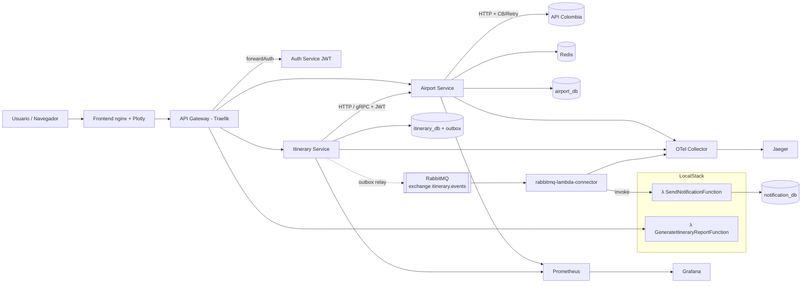

# 01 — Arquitectura y decisiones

## Vista general



## Stack tecnológico

| Capa | Tecnología | Motivo |
|---|---|---|
| Servicios | Python 3.12, **FastAPI**, Uvicorn | Swagger automático, Pydantic nativo, async |
| Modelos | **Pydantic v2** | Requisito explícito |
| Persistencia | **PostgreSQL 16** (una BD por servicio), SQLAlchemy 2.0 | Relacional, transacciones para Outbox |
| Migraciones | **Alembic** por servicio | Requisito explícito |
| HTTP cliente | `httpx` (async) | Timeouts finos |
| Resiliencia | `tenacity` (retry + backoff + jitter), `pybreaker` / CB propio | Nivel 2 |
| Caché | **Redis 7** | Nivel 2 |
| Broker | **RabbitMQ 3.13** (exchange topic + DLX) | Event-driven, DLQ para alerting |
| Serverless | **LocalStack** (AWS Lambda, Python runtime) | FaaS local |
| Gateway | **Traefik v3** (rate limit, forwardAuth) | Sin lógica de negocio, config declarativa |
| Auth | Microservicio mínimo FastAPI que emite/valida JWT (HS256 / RS256) | Propagación JWT |
| Observabilidad | OpenTelemetry SDK + Collector, **Jaeger**, **Prometheus**, **Grafana**, `structlog` (logs JSON) | Nivel 1 (logs) + Nivel 2 (trazas) + Nivel 3 (alertas) |
| Frontend | HTML + JS vanilla + **Plotly JS**, servido por nginx | Simple, sin build |
| Pruebas | pytest, pytest-asyncio, **Testcontainers**, **Locust**, **Pact**, coverage | Rúbrica |
| Calidad | **SonarQube** + Ruff + mypy | Rúbrica |
| CI/CD | **GitHub Actions** + GHCR | Rúbrica / Nivel 3 |
| Contrato async | **AsyncAPI 3.0** | Nivel 2 |

## Arquitectura hexagonal (plantilla para cada servicio)

```
<service>/
├── app/
│   ├── domain/              # Entidades, value objects, eventos de dominio, excepciones. SIN imports de frameworks
│   │   ├── model.py
│   │   ├── events.py
│   │   └── exceptions.py
│   ├── application/         # Casos de uso + puertos (interfaces ABC/Protocol)
│   │   ├── ports.py         # p.ej. AirportProvider, ItineraryRepository, AirportValidator
│   │   └── use_cases.py
│   ├── infrastructure/      # Adapters: HTTP externos, SQLAlchemy, Redis, RabbitMQ, OTel
│   │   ├── adapters/
│   │   ├── db/
│   │   └── config.py        # pydantic-settings
│   └── api/                 # Adapters de entrada: routers FastAPI, schemas Pydantic, handlers de error
│       ├── v1/
│       ├── schemas.py
│       └── errors.py
├── migrations/              # Alembic
├── tests/{unit,integration,contract}/
├── Dockerfile
├── docker-compose.yml       # compose propio del servicio (rúbrica: compose por servicio)
├── pyproject.toml
└── sonar-project.properties
```

Regla de dependencias: `api → application → domain` e `infrastructure → application/domain`. El dominio no conoce FastAPI, SQLAlchemy ni httpx. Se valida con **import-linter** en CI.

## Estructura del monorepo

```
itinerario/
├── services/
│   ├── airport-service/
│   ├── itinerary-service/
│   ├── auth-service/
│   └── outbox-relay/            # (o proceso dentro de itinerary-service, ver ADR-003)
├── functions/
│   ├── send-notification/
│   ├── generate-report/
│   └── rabbitmq-lambda-connector/
├── frontend/
├── gateway/                     # traefik.yml + dynamic config
├── infra/
│   ├── observability/           # otel-collector, prometheus, grafana, alert rules
│   ├── rabbitmq/                # definitions.json (exchanges, colas, DLX)
│   ├── localstack/              # init scripts para desplegar lambdas
│   └── k8s/                     # opcional Nivel 3
├── contracts/
│   ├── asyncapi.yaml
│   ├── proto/                   # opcional gRPC
│   └── pacts/
├── tests/
│   ├── e2e/                     # Testcontainers
│   └── load/                    # Locust
├── docs/
│   ├── planning/                # este plan
│   ├── architecture.md          # documento corto de arquitectura (rúbrica)
│   ├── adr/
│   └── diagrams/
├── .github/workflows/
├── docker-compose.yml           # sistema completo
└── README.md
```

> Decisión: **monorepo** con un `docker-compose.yml` por servicio + uno raíz que los compone (`include:`). Si el profesor exige “repos en git” por servicio, se puede dividir con `git subtree split` sin cambiar la estructura.

## ADRs (decisiones)

Se registran en `docs/adr/` con formato *Contexto / Decisión / Consecuencias*.

| ADR | Decisión |
|---|---|
| ADR-001 | Python + FastAPI para todos los servicios |
| ADR-002 | PostgreSQL con una base de datos lógica por servicio (`airport_db`, `itinerary_db`, `notification_db`) en una instancia para desarrollo; contenedores separados en compose “prod-like” |
| ADR-003 | Transactional Outbox con **polling publisher** (worker separado `outbox-relay`, `SELECT … FOR UPDATE SKIP LOCKED`). CDC con Debezium descartado por complejidad |
| ADR-004 | Disparo de Lambda: RabbitMQ → `rabbitmq-lambda-connector` → `lambda.invoke` (LocalStack). El conector no tiene lógica de negocio; ack solo tras invocación exitosa; DLQ tras N fallos |
| ADR-005 | Aeropuerto como **referencia de valor** en Itinerary (solo `airport_id` + snapshot mínimo `code`, `name`), no agregado completo. Ver [02-ddd.md](02-ddd.md) |
| ADR-006 | Traefik como gateway; JWT validado en gateway (forwardAuth) **y** en cada servicio (defensa en profundidad); el header `Authorization` se propaga |
| ADR-007 | Comunicación Itinerary→Airport por HTTP en Nivel 1/2; gRPC opcional en Nivel 3 detrás del mismo puerto `AirportValidator` |
| ADR-008 | Versionado de API por URL (`/api/v1/...`) y paginación `limit/offset` |
