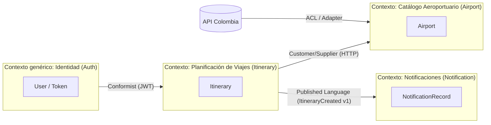

# 02 — DDD: contextos delimitados y lenguaje ubicuo

## Contextos delimitados



| Contexto | Tipo | Responsabilidad | Relación |
|---|---|---|---|
| Catálogo Aeroportuario | Soporte | Exponer aeropuertos en el modelo propio | **Anti-Corruption Layer** frente a API Colombia (Adapter) |
| Planificación de Viajes | **Core** | Ciclo de vida del itinerario | Cliente de Airport (Customer/Supplier); publica eventos |
| Notificaciones | Soporte | Reaccionar a eventos, registrar historial, reportes | Consume **Published Language** (`ItineraryCreated` v1, AsyncAPI) |
| Identidad | Genérico | Emitir y validar JWT | Conformista |

## Lenguaje ubicuo

| Término | Definición | Contexto |
|---|---|---|
| **Aeropuerto (Airport)** | Infraestructura aérea colombiana con id, nombre, código IATA/OACI, ciudad, departamento, coordenadas | Airport |
| **Coordenadas (Coordinates)** | Value object `latitude`, `longitude` válidos | Airport |
| **Proveedor de aeropuertos (AirportProvider)** | Puerto que abstrae la fuente externa | Airport |
| **Punto de mapa (MapPoint)** | Representación de un aeropuerto en formato Plotly (`lat`, `lon`, `text`) | Airport |
| **Itinerario (Itinerary)** | Plan de viaje de un viajero entre dos aeropuertos en una fecha | Itinerary |
| **Viajero (Traveler)** | Nombre del usuario dueño del itinerario (sub del JWT) | Itinerary |
| **Aeropuerto de salida / llegada** | Referencia de valor (`AirportRef`) a un aeropuerto existente | Itinerary |
| **Fecha de viaje (TravelDate)** | Fecha del viaje, no puede ser pasada al crear | Itinerary |
| **Duración (DurationMinutes)** | Duración en minutos, entero > 0 | Itinerary |
| **Mensaje de salida (OutboxMessage)** | Evento de integración pendiente de publicar, guardado en la misma transacción | Itinerary |
| **Notificación (Notification)** | Registro del aviso enviado al viajero | Notification |
| **Reporte de itinerarios (ItineraryReport)** | Métricas consolidadas bajo demanda | Notification |

## Agregados

### Itinerary (raíz de agregado)

```
Itinerary
 ├─ id: UUID
 ├─ traveler_name: str
 ├─ origin: AirportRef        (value object)
 ├─ destination: AirportRef   (value object)
 ├─ travel_date: date
 ├─ duration_minutes: DurationMinutes
 ├─ created_at / updated_at
 └─ version (optimistic locking)
```

Invariantes:
- `origin.airport_id != destination.airport_id`.
- `duration_minutes > 0` (y ≤ 1440 como regla razonable).
- `travel_date >= hoy` al crear/actualizar.
- Ambos aeropuertos deben existir (validado vía puerto `AirportValidator` antes de persistir).

### Decisión: Aeropuerto como referencia de valor vs. agregado completo (ADR-005)

**Decisión: referencia de valor (`AirportRef`)**.

- El aeropuerto **no pertenece** al contexto de Planificación; su ciclo de vida lo gobierna el Catálogo.
- Copiarlo entero acoplaría ambos contextos y duplicaría la fuente de verdad.
- Se guarda `airport_id` + snapshot inmutable (`code`, `name`) tomado al validar, útil para mostrar el itinerario aunque Airport Service esté caído.
- Nivel 2/3: copia local optimizada (tabla `airport_ref_cache` / Redis) como fallback de validación.

## Eventos de dominio vs. eventos de integración

| | Evento de dominio | Evento de integración |
|---|---|---|
| Ejemplo | `ItineraryCreated` (objeto Python en `domain/events.py`) | `ItineraryCreatedEvent` v1 (JSON en RabbitMQ) |
| Alcance | Dentro del contexto/proceso | Entre contextos/servicios |
| Transporte | En memoria, despachado por el caso de uso | Outbox → RabbitMQ |
| Contrato | Libre, puede cambiar | Versionado, documentado en AsyncAPI, compatible hacia atrás |
| Contenido | Puede referenciar entidades | Solo datos serializables, ids, `event_id`, `occurred_at`, `trace_id` |

Flujo: el agregado registra el evento de dominio → el caso de uso lo traduce a evento de integración y lo inserta en `outbox` en la misma transacción.
