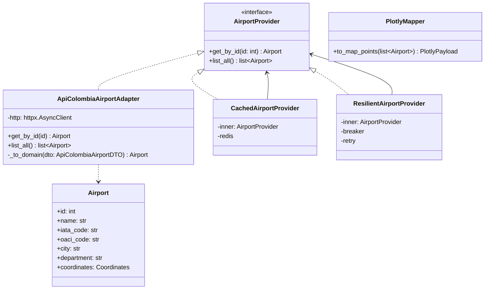

# 03 — Airport Service (Microservicio)

## Responsabilidades

- Consumir API Colombia (`GET https://api-colombia.com/api/v1/Airport`, `/Airport/{id}`).
- **Adapter**: traducir la respuesta externa al modelo de dominio `Airport`.
- Transformar a formato Plotly (`MapPoint`).
- Exponer REST por ID y listado.
- Resiliencia: timeout, retry con backoff exponencial + jitter, circuit breaker, fallback.
- Caché Redis con TTL e invalidación.

## Patrón Adapter (Puerto / Adapter)



- **Puerto** (`application/ports.py`): `AirportProvider(ABC)`.
- **Adapter** (`infrastructure/adapters/api_colombia.py`): `ApiColombiaAirportAdapter` con DTO Pydantic `ApiColombiaAirportDTO` que refleja el JSON externo (`iataCode`, `oaciCode`, `latitude`, `longitude`, `city{name}`, `department{name}`…) y `_to_domain()`.
- **Decoradores** (mismo puerto): `ResilientAirportProvider` y `CachedAirportProvider`. Composición en `main.py`: `Cached(Resilient(ApiColombia()))`.
- El frontend solo ve `AirportResponse` / `PlotlyPayload` — nunca el JSON de API Colombia.

## Endpoints (`/api/v1`)

| Método | Ruta | Respuesta | Errores |
|---|---|---|---|
| GET | `/airports?limit=&offset=` | Página de `AirportResponse` | 503 si CB abierto y sin caché |
| GET | `/airports/{id}` | `AirportResponse` | 404 no existe, 503 dependencia caída, 422 id inválido |
| GET | `/airports/{id}/map` | `PlotlyPayload` de un aeropuerto | 404 / 503 |
| GET | `/airports/map` | `PlotlyPayload` de todos | 503 |
| HEAD | `/airports/{id}` | 200/404 (validación barata para Itinerary) | |
| DELETE | `/admin/cache` / `/admin/cache/{id}` | 204 — invalidación manual | 401/403 |
| GET | `/health/live`, `/health/ready` | Probes | |
| GET | `/metrics` | Prometheus | |

Formato de error consistente (todos los servicios, RFC 7807):

```json
{ "type": "about:blank", "title": "Airport not found", "status": 404,
  "detail": "Airport 999 does not exist", "instance": "/api/v1/airports/999", "trace_id": "..." }
```

`PlotlyPayload`:

```json
{ "type": "scattergeo", "lat": [4.70], "lon": [-74.14], "text": ["El Dorado (BOG) - Bogotá"],
  "ids": [1], "layout": { "geo": { "scope": "south america", "center": {"lat": 4.6, "lon": -74.1} } } }
```

## Resiliencia (Nivel 2)

| Mecanismo | Configuración inicial |
|---|---|
| Timeout | connect 2 s, read 3 s (`httpx.Timeout`) |
| Retry | `tenacity`: 3 intentos, `wait_exponential_jitter(initial=0.2, max=2)`, solo en 5xx/timeout/conexión (no en 404) |
| Circuit breaker | Abre tras 5 fallos consecutivos, half-open a los 30 s, estado expuesto en métrica `airport_circuit_breaker_state` |
| Fallback | Si CB abierto → caché Redis (aunque esté expirada: *stale-while-error*) → si no hay, 503 con `Retry-After` |
| Bulkhead (N3) | `asyncio.Semaphore(10)` para llamadas externas y pool de conexiones BD separado |

## Caché Redis

- Claves: `airport:v1:{id}`, `airport:v1:all`. TTL 1 h (configurable). Copia “stale” sin TTL en `airport:v1:stale:{id}` para fallback.
- Invalidación: endpoint admin + TTL + invalidación total al cambiar versión de esquema (prefijo `v1`).
- Métricas: `airport_cache_hits_total`, `airport_cache_misses_total`.

## Base de datos (airport_db)

Aunque la fuente es externa, se cumple “BD por servicio” y migraciones:
- `airport_snapshot` (id, payload normalizado, fetched_at) — persistencia de último conocido, fuente de la copia local para nivel 2/3.
- `alembic` con migración `0001_create_airport_snapshot`.

## Pruebas

- Unitarias: `_to_domain` con fixtures del JSON real; mapper Plotly; reglas de Coordinates.
- Resiliencia: `respx` para simular 500/timeout → verificar retries, apertura del CB y fallback.
- Integración: Redis con Testcontainers.
- Contrato (N3): **proveedor** Pact verificando los pacts de Itinerary y Frontend.

## Tareas

1. Scaffold hexagonal + `pyproject` + Dockerfile + compose propio.
2. Dominio `Airport`, `Coordinates`, excepciones.
3. Puerto + DTO + Adapter API Colombia + tests.
4. Casos de uso `GetAirport`, `ListAirports`, `GetAirportMap`.
5. Routers, schemas, manejador de errores RFC 7807, Swagger con ejemplos.
6. Logs JSON + correlation ID.
7. Redis cache + invalidación.
8. Retry + CB + fallback + métricas.
9. Alembic + snapshot.
10. OTel instrumentación (FastAPI, httpx, redis).
