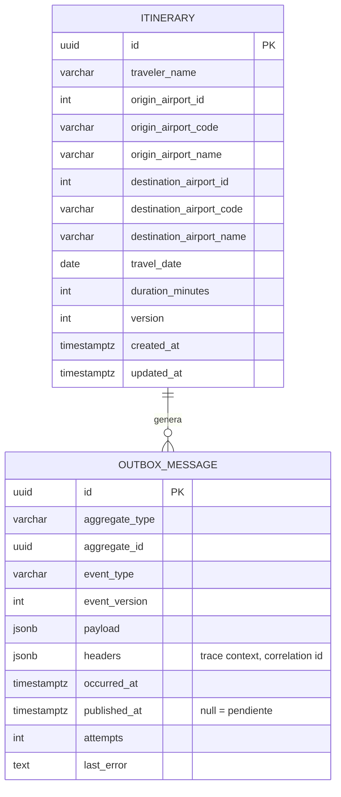

# 04 — Itinerary Service (Microservicios + Eventos)

## Responsabilidades

- CRUD completo de itinerarios en su propia BD (`itinerary_db`).
- Validar aeropuertos vía `AirportValidator` (HTTP al Airport Service; copia local en N2/N3).
- Publicar `ItineraryCreatedEvent` (y `Updated`/`Deleted`) con **Transactional Outbox**.
- Manejo de errores HTTP consistente (RFC 7807).

## Modelo relacional



Restricciones: `CHECK (duration_minutes > 0)`, `CHECK (origin_airport_id <> destination_airport_id)`, índice parcial `outbox_message(occurred_at) WHERE published_at IS NULL`.

Migraciones Alembic: `0001_create_itinerary`, `0002_create_outbox`, `0003_add_version_column`…

## Puertos

```python
class ItineraryRepository(ABC):        # adapter: SqlAlchemyItineraryRepository
class AirportValidator(ABC):           # adapters: HttpAirportValidator, (N3) GrpcAirportValidator, CachedAirportValidator
    async def get_ref(self, airport_id: int) -> AirportRef: ...   # lanza AirportNotFound / AirportServiceUnavailable
class OutboxWriter(ABC):               # adapter: SqlAlchemyOutboxWriter (misma sesión/transacción)
class UnitOfWork(ABC):                 # commit atómico de itinerario + outbox
```

## Endpoints (`/api/v1/itineraries`)

| Método | Ruta | Éxito | Errores |
|---|---|---|---|
| POST | `/` | 201 + `Location` | 422 validación, 404/422 aeropuerto inexistente, 503 Airport caído, 401 |
| GET | `/?limit=&offset=&traveler=` | 200 página | 401 |
| GET | `/{id}` | 200 | 404 |
| PUT | `/{id}` | 200 (requiere `If-Match`/`version`) | 404, 409 conflicto de versión, 422 |
| DELETE | `/{id}` | 204 | 404 |
| GET | `/health/live`, `/health/ready`, `/metrics` | | |

Mapeo de excepciones de dominio → HTTP centralizado en `api/errors.py` (`ItineraryNotFound→404`, `AirportNotFound→422`, `InvalidItinerary→422`, `AirportServiceUnavailable→503`, `ConcurrencyConflict→409`).

## Flujo de creación

```mermaid
sequenceDiagram
    participant FE as Frontend
    participant GW as Gateway
    participant IS as Itinerary Service
    participant AS as Airport Service
    participant DB as itinerary_db
    participant RL as Outbox Relay
    participant MQ as RabbitMQ
    FE->>GW: POST /api/v1/itineraries (JWT)
    GW->>GW: rate limit + forwardAuth
    GW->>IS: POST (Authorization, traceparent)
    IS->>AS: GET /airports/{origin} (JWT propagado)
    IS->>AS: GET /airports/{destination}
    AS-->>IS: 200 AirportResponse
    IS->>DB: BEGIN; INSERT itinerary; INSERT outbox_message; COMMIT
    IS-->>FE: 201 Created
    loop cada 1s
      RL->>DB: SELECT ... WHERE published_at IS NULL FOR UPDATE SKIP LOCKED
      RL->>MQ: publish itinerary.created (publisher confirms)
      RL->>DB: UPDATE published_at = now()
    end
```

## Transactional Outbox (Double Write Problem)

**Problema:** guardar en BD y publicar en el broker son dos escrituras en sistemas distintos; si una falla se pierde el evento o se publica un evento de algo que no existe.

**Solución:**
1. El caso de uso inserta itinerario + `outbox_message` en **una sola transacción** (UnitOfWork).
2. `outbox-relay` (proceso separado, mismo código base) hace polling con `FOR UPDATE SKIP LOCKED` (permite varias réplicas sin duplicar trabajo), publica con **publisher confirms** y marca `published_at`.
3. Garantía **at-least-once** → los consumidores son **idempotentes** usando `event_id` (tabla `processed_event` en notification_db).
4. Reintentos con backoff por mensaje (`attempts`, `last_error`); tras N intentos queda para alerta.
5. Limpieza periódica de mensajes publicados > 7 días.

## Validación de aeropuertos por nivel

| Nivel | Estrategia |
|---|---|
| 1 | `HttpAirportValidator` → `GET /api/v1/airports/{id}` |
| 2 | + timeout/retry/CB en el cliente + propagación JWT + `traceparent` |
| 3 | `CachedAirportValidator` (copia local `airport_ref` o Redis) y/o gRPC (`contracts/proto/airport.proto`) |

## Pruebas

- Unitarias: invariantes del agregado, casos de uso con fakes de puertos (sin BD).
- Integración: repositorio + Alembic sobre PostgreSQL (Testcontainers); atomicidad de outbox (rollback ⇒ sin mensaje).
- Relay: publica y marca; con broker caído, no marca y reintenta.
- Contrato (N3): **consumidor** Pact de Airport Service.

## Tareas

1. Scaffold hexagonal + Docker + compose propio.
2. Dominio `Itinerary`, `AirportRef`, `DurationMinutes`, eventos, excepciones.
3. Puertos + casos de uso CRUD (con fakes y tests).
4. SQLAlchemy + Alembic + UnitOfWork.
5. `HttpAirportValidator` con propagación JWT/trace.
6. Routers + errores + paginación + Swagger.
7. Outbox (tabla, writer, relay, métricas `outbox_pending_messages`).
8. Logs JSON + OTel (incluye inyectar contexto de traza en headers del mensaje).
