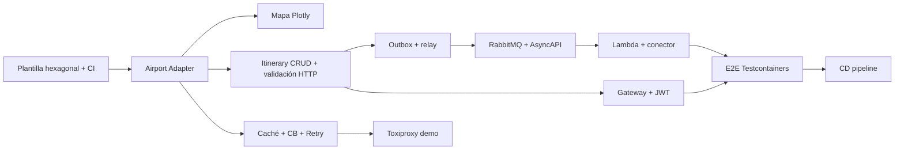

# 10 — Roadmap por sprints

Sprints de 1 semana. Ajustar fechas al calendario del curso. Cada sprint cierra con release a `main` (tag) y demo.

| Sprint | Objetivo | Historias | Hito / entregable |
|---|---|---|---|
| **S0 — Setup** | Fundaciones DevOps | H-01, H-02, H-03, H-04, H-06 (esqueleto) | Repo, Jira, plantilla de servicio, CI verde con “hello service” |
| **S1 — Nivel 1: Airport** | Adapter + mapa | H-10, H-11, H-12, H-13, H-14, H-50 | Mapa Plotly mostrando aeropuertos reales. `v0.1.0` |
| **S2 — Nivel 1: Itinerary** | CRUD + validación | H-20, H-21, H-22, H-51, H-70 (parcial), H-05 | CRUD completo vía UI, Sonar activo. `v0.2.0` (**Nivel 1 completo**) |
| **S3 — Nivel 2: Resiliencia y gateway** | CB, retry, caché, gateway, JWT | H-15, H-16, H-17, H-40, H-41, H-42, H-43, H-23 | Demo de CB con Toxiproxy (H-73). `v0.3.0` |
| **S4 — Nivel 2: Eventos y serverless** | Broker, Lambda, AsyncAPI | H-30, H-31, H-32, H-33, H-24 (outbox) | Crear itinerario ⇒ notificación en BD. `v0.4.0` |
| **S5 — Nivel 2: Observabilidad y E2E** | Jaeger, Grafana, E2E, carga | H-60, H-61, H-71, H-72, H-52 | Traza completa en Jaeger; reporte Locust. `v0.5.0` (**Nivel 2 completo**) |
| **S6 — Nivel 3 y CD** | Bonus priorizados | H-34, H-25, H-18, H-62, H-74, H-80, H-75 (+ opc. H-81/H-82/H-44/H-35) | Pipeline CD, alertas, Pact. `v0.6.0` |
| **S7 — Cierre** | Documentación y evidencias | H-90, H-91, H-92 | README final, video, autoevaluación. `v1.0.0` |

## Orden crítico de dependencias

## Definition of Ready

- Historia con criterios de aceptación, estimada, sin bloqueos, con diseño (endpoint/evento) definido.

## Definition of Done

- [ ] Código en rama `feature/ITIN-n-*`, PR aprobado y mergeado a `develop`.
- [ ] CI verde: lint, mypy, import-linter, tests, Sonar quality gate.
- [ ] Pruebas unitarias del cambio (y de integración si toca infraestructura).
- [ ] Swagger actualizado con ejemplos y respuestas de error.
- [ ] Migración Alembic si cambia el esquema.
- [ ] Logs JSON y trazas en el nuevo flujo.
- [ ] Funciona con `make up`.
- [ ] README/ADR/diagramas actualizados si aplica.
- [ ] Issue de Jira en `Done`.

## Reparto del equipo (2 integrantes)

El equipo son **dos personas**: **Elizabeth Pérez González** y **María Fernanda Ceballos**. Cada una es dueña de un contexto delimitado (un microservicio de punta a punta), y lo transversal se reparte según afinidad. El detalle por issue, con estado, prioridad y fechas, está en [docs/gestion/jira.md](../gestion/jira.md) y [docs/gestion/estado-jira.md](../gestion/estado-jira.md). La fuente de esos datos es `jira/backlog.csv`.

| Sprint | Elizabeth Pérez González | María Fernanda Ceballos | Compartido |
|---|---|---|---|
| **S0 — Setup** | docker-compose por servicio | Jira, pipeline CI | Repositorio, ramas, plantilla de PR |
| **S1 — Airport** | Adapter API Colombia, corrección de coordenadas, mapa Plotly | — | — |
| **S2 — Itinerary** | — | Agregado Itinerary, CRUD, migraciones | — |
| **S3 — Resiliencia y gateway** | Caché Redis, retry, circuit breaker, gateway nginx, Auth JWT, frontend | — | — |
| **S4 — Eventos y serverless** | — | Outbox + relay, RabbitMQ + AsyncAPI, Lambda + conector | — |
| **S5 — Observabilidad** | — | Logs JSON, Jaeger, SonarQube | Swagger, revisión en clase |
| **S6 — Nivel 3 + pruebas (correcciones)** | gRPC, mTLS, Vault, Kubernetes, Chaos Mesh, Selenium, documento de arquitectura | Pact, Prometheus + alertas + Grafana, pruebas de eventos, Testcontainers, Locust, README, DevOps, Jira | Informe de pruebas (rama `pruebas`) |
| **S7 — Cierre** | Mejora del circuit breaker (hallazgo de caos) | — | Sustentación final |

| Integrante | Issues asignados | Foco |
|---|---|---|
| Elizabeth Pérez González | 17 | Airport Service, resiliencia, gateway, seguridad (JWT, gRPC/mTLS, Vault), Kubernetes, caos, Selenium, arquitectura |
| María Fernanda Ceballos | 18 | Itinerary Service, eventos, outbox, serverless, Pact, observabilidad y alertas, CI/CD, pruebas de eventos y carga, DevOps, Jira |
| Compartido | 6 | Repositorio, Swagger, informe de pruebas, roadmap, sustentación |
