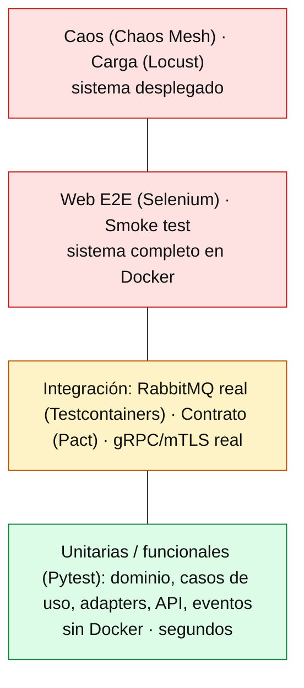
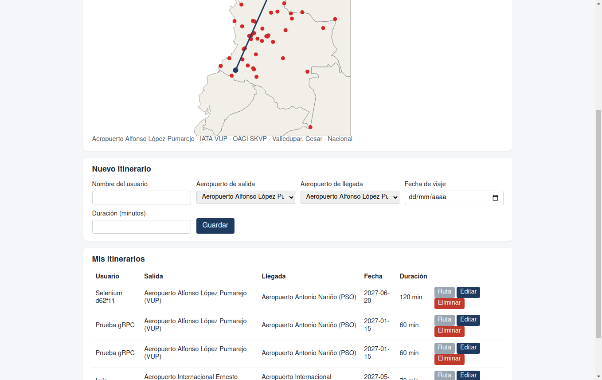
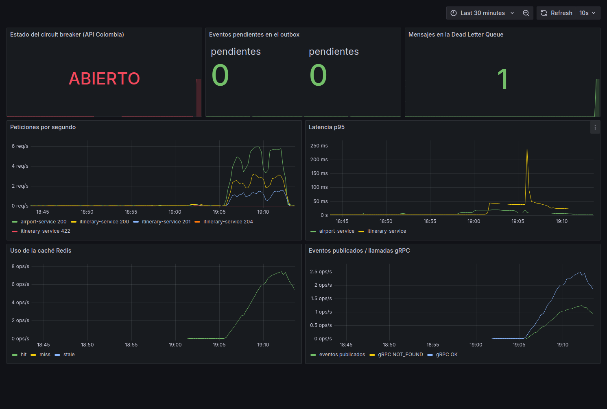
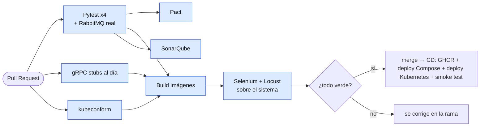

# Informe de pruebas — Sistema de Itinerarios Personales

| | |
|---|---|
| **Equipo** | Elizabeth Pérez González · María Fernanda Ceballos |
| **Rama** | `pruebas` |
| **Fecha de ejecución** | 18/11/2026 |
| **Versión probada** | Sistema con nivel 3 (gRPC + mTLS, Vault, alertas, Pact, Kubernetes, Chaos Mesh) |
| **Entorno** | Windows 11 + Docker Desktop (8 GB, 12 CPU). Python 3.14 local, imágenes Python 3.12. k3s v1.31 en Docker para Kubernetes |

## 1. Resumen ejecutivo

| Tipo de prueba | Herramienta | Casos | Resultado | Responsable |
|---|---|---|---|---|
| Unitarias y funcionales | Pytest | 83 | ✅ 83/83 | Ambas (cada una su servicio) |
| Eventos en la arquitectura hexagonal | Pytest | 13 (incluidas en las 83) | ✅ 13/13 | María Fernanda |
| Eventos con broker real | Pytest + Testcontainers | 3 (incluidas en las 83) | ✅ 3/3 | María Fernanda |
| Contrato del evento | Pact | 3 (incluidas en las 83) | ✅ 3/3 | María Fernanda |
| Seguridad mTLS / Vault | Pytest + trustme | 3 + 18 (incluidas en las 83) | ✅ | Elizabeth |
| Automatización web | Selenium | 9 | ✅ 9/9 | Elizabeth |
| Carga nominal | Locust | 915 peticiones | ✅ 0 errores · p95 72 ms | María Fernanda |
| Estrés | Locust | 4.722 peticiones | ✅ 0 errores · 0 respuestas 5xx | María Fernanda |
| E2E de sistema completo | Pytest + Testcontainers (Compose) | 1 flujo | ✅ 1/1 (57 s) | Ambas |
| Despliegue | Smoke test | 5 pasos | ✅ (Compose y Kubernetes) | Ambas |
| Alertas | Prometheus + Alertmanager | 2 escenarios | ✅ disparadas y recibidas | María Fernanda |
| Caos | Chaos Mesh (Kubernetes) | 3 experimentos | ✅ 3/3 hipótesis, 2 hallazgos | Elizabeth |

**Conclusión:**
- Todas las pruebas pasan.
- El sistema cumple los requisitos funcionales, mantiene la consistencia de los eventos ante fallos del broker y se degrada con elegancia cuando API Colombia falla.
- El gateway protege a los servicios bajo estrés.
- Las pruebas de caos encontraron **dos problemas reales** que las demás pruebas no detectaron: uno se corrigió y el otro quedó como mejora planificada (sección 9).

## 2. Estrategia de pruebas

Seguimos la **pirámide de pruebas**: muchas pruebas rápidas y aisladas en la base, y pocas pruebas lentas de sistema completo arriba.



| Principio | Cómo lo aplicamos |
|---|---|
| Probar el dominio sin infraestructura | Gracias a la arquitectura hexagonal, el dominio y los casos de uso se prueban con *fakes* de los puertos (`InMemoryRepository`, `FakeAirportChecker`) |
| Probar los adapters contra la tecnología real | gRPC con servidor real y certificados reales; RabbitMQ real con Testcontainers; SQLite en memoria para el outbox |
| Probar los contratos entre equipos | Pact (evento), esquema AsyncAPI (JSON Schema), stubs gRPC generados desde el `.proto` |
| Probar como el usuario | Selenium en un Chrome real, a través del gateway |
| Probar en condiciones adversas | Locust (carga y estrés), Chaos Mesh (fallos de pods y de red), `docker-compose.chaos.yml` |
| Automatizar dentro del ciclo DevOps | Todo corre en GitHub Actions ([ci.yml](../../.github/workflows/ci.yml)) en cada PR (ver sección 10) |

## 3. Pruebas funcionales con Pytest

**Qué:** comportamiento de cada microservicio: reglas de negocio, casos de uso, adapters, endpoints REST, códigos de error, seguridad JWT, resiliencia (retry, circuit breaker, caché), gRPC/mTLS y Vault.

**Cómo:**
```bash
cd services/<servicio> && pip install -r requirements-dev.txt
pytest -v --cov=app --cov-report=term
cd functions/send-notification && pip install -r requirements-dev.txt && pytest tests -v
```

**Resultados:**

| Componente | Pruebas | Resultado | Cobertura |
|---|---|---|---|
| airport-service | 28 | ✅ 28/28 | **86 %** |
| itinerary-service | 44 | ✅ 44/44 | **83 %** |
| auth-service | 8 | ✅ 8/8 | **82 %** |
| Lambda send-notification | 3 | ✅ 3/3 | 79 % (handler) |
| **Total** | **83** | **✅ 83/83** | |

<details>
<summary><b>Detalle de casos por servicio</b> (clic para expandir)</summary>

**airport-service (28)**

| Archivo | Caso | Qué verifica |
|---|---|---|
| test_adapter.py | `traduce_respuesta_externa_al_modelo_de_dominio` | Patrón Adapter: camelCase → dominio, coordenadas corregidas |
| | `coordenadas_0_0_se_consideran_desconocidas` | Dato erróneo de API Colombia → `None` |
| | `404_de_la_api_se_traduce_a_airport_not_found` | Error externo → excepción de dominio |
| | `reintenta_3_veces_ante_error_500_y_luego_falla` | Retry con backoff |
| | `circuit_breaker_abierto_no_llama_a_la_api` | Falla rápido con el circuito abierto |
| test_api.py | 5 casos | 200, 404, 503, mapa Plotly, 401 sin token |
| test_cache.py | 3 casos | Hit de caché, fallback *stale*, error si no hay copia |
| test_circuit_breaker.py | 2 casos | CLOSED → OPEN → HALF_OPEN → CLOSED / OPEN |
| test_grpc.py | 4 sin TLS | Mapeo a Protobuf, `has_coordinates`, NOT_FOUND, UNAVAILABLE |
| | 3 con **mTLS** | CN autorizado ✅ · CN no permitido → `PERMISSION_DENIED` · sin certificado → no conecta |
| test_vault.py | 6 casos | Secretos desde variables de entorno / KV, emisión de certificado PKI |

**itinerary-service (44)**

| Archivo | Casos | Qué verifica |
|---|---|---|
| test_domain.py | 5 | Invariantes del agregado (nombre, aeropuertos distintos, duración, fecha) |
| test_service.py | 4 | Casos de uso con puertos falsos |
| test_api.py | 4 | CRUD completo, 422 por aeropuerto inexistente o datos inválidos, 401 |
| test_outbox.py | 3 | Repositorio SQL + outbox + relay |
| test_airport_grpc_client.py | 4 | Adapter gRPC: OK → True, NOT_FOUND → False, caído → `AirportServiceUnavailable` |
| **test_eventos.py** | **13** | Sección 4 |
| **test_eventos_rabbitmq.py** | **3** | Sección 4 |
| **test_pact_provider.py** | **2** | Sección 5 |
| test_vault.py | 6 | Vault |

**auth-service (8):** login correcto (JWT válido), login incorrecto (401) y 6 de Vault.
**Lambda (3):** guarda la notificación, **idempotencia** ante eventos duplicados y contrato Pact (consumidor).

</details>

**Hallazgos durante la ejecución:**
- Ninguna prueba de producción falló.
- Se corrigió una aserción mal escrita en la prueba web CP-WEB-05: esperaba otro texto de error.

## 4. Pruebas de eventos en la arquitectura hexagonal

**Qué:** que el evento `ItineraryCreated` recorra correctamente **cada capa** de la arquitectura hexagonal, y que el Transactional Outbox garantice que ningún evento se pierda ni se duplique.

**Cómo:** [test_eventos.py](../../services/itinerary-service/tests/test_eventos.py) prueba sin Docker, capa por capa. [test_eventos_rabbitmq.py](../../services/itinerary-service/tests/test_eventos_rabbitmq.py) usa un **RabbitMQ real**: Testcontainers levanta `rabbitmq:3.13-alpine` y lo destruye al terminar.


| Capa | Caso | Resultado |
|---|---|---|
| Dominio | Crear registra **un** evento con los datos del agregado | ✅ |
| Dominio | `pull_events()` entrega cada evento una sola vez | ✅ |
| Dominio | Actualizar **no** emite `ItineraryCreated` | ✅ |
| Dominio | Si falla una regla de negocio no se emite evento | ✅ |
| Aplicación | El caso de uso entrega el evento al **puerto** (no publica directamente) | ✅ |
| Aplicación | Si el aeropuerto no existe, no hay evento | ✅ |
| Infraestructura | El evento de integración **cumple el esquema AsyncAPI** (validado con jsonschema contra `contracts/asyncapi.yaml`) | ✅ |
| Infraestructura | El evento es JSON puro (sin tipos de dominio) | ✅ |
| Outbox | Itinerario y evento se guardan juntos | ✅ |
| Outbox | **Si falla guardar el evento, tampoco se guarda el itinerario** (atomicidad: Double Write) | ✅ |
| Relay | Publica con routing key, `message_id = event_id` y mensaje persistente | ✅ |
| Relay | **Si el broker falla, el evento sigue pendiente y se publica después** (at-least-once) | ✅ |
| Relay | No vuelve a publicar lo ya publicado | ✅ |
| RabbitMQ real | El evento llega a `notifications.itinerary-created` | ✅ |
| RabbitMQ real | Un mensaje rechazado (`nack`) **termina en la DLQ** intacto | ✅ |
| RabbitMQ real | Varios eventos llegan en orden | ✅ |

**Qué arrojaron:** 16/16. La garantía *at-least-once* + idempotencia y la atomicidad del outbox quedan demostradas con pruebas automáticas, y no solo descritas.

## 5. Pruebas de contrato (Pact)

**Qué:** que el evento que **publica** el Itinerary Service sea exactamente el que la Lambda **sabe procesar**, sin levantar ninguno de los dos sistemas.

**Cómo:**
1. **Consumidor** ([test_pact_consumer.py](../../functions/send-notification/tests/test_pact_consumer.py)). La Lambda declara qué campos y tipos necesita (UUID, enteros, fecha `yyyy-MM-dd`…). Pact le pasa un mensaje de ejemplo a `process_event()` y escribe el contrato en [contracts/pacts/](../../contracts/pacts/).
2. **Proveedor** ([test_pact_provider.py](../../services/itinerary-service/tests/test_pact_provider.py)). Construye el evento con el **código de producción** (`Itinerary.create → pull_events → to_integration_event`) y Pact verifica que cumple el contrato.
3. **Prueba negativa:** renombrar `user_name` → `username` en el evento **hace fallar** la verificación.

**Resultado:** ✅ 3/3. Durante el desarrollo, Pact detectó un error real en el contrato: el formato de fecha estaba mal declarado.

## 6. Automatización web con Selenium

**Qué:** los casos de uso del usuario final, en un **Chrome real**, pasando por el gateway como lo haría una persona.

**Cómo:**
```bash
docker compose up -d && docker compose --profile tests up -d selenium
pip install -r tests/web/requirements.txt && pytest tests/web -v
# ver el navegador en vivo: http://localhost:7900 (clave: secret)
```
- Chrome corre en el contenedor `selenium/standalone-chrome` y abre `http://gateway`.
- Las esperas son explícitas (`WebDriverWait`), sin `sleep` fijos.
- Cada caso guarda una **captura de pantalla** en [evidencias/](evidencias/).

| ID | Caso de prueba | Resultado esperado | Resultado | Evidencia |
|---|---|---|---|---|
| CP-WEB-01 | Login con contraseña incorrecta | Alerta "Usuario o contraseña incorrectos"; la app sigue oculta | ✅ | [png](evidencias/test_cp_web_01_login_incorrecto_muestra_error.png) |
| CP-WEB-02 | Login correcto | Mapa con ≥ 40 aeropuertos, todos con latitud entre −5 y 14 (dentro de Colombia) | ✅ | [png](evidencias/test_cp_web_02_login_correcto_muestra_mapa_de_colombia.png) |
| CP-WEB-03 | Clic en un aeropuerto del mapa | Detalle con IATA y OACI | ✅ | [png](evidencias/test_cp_web_03_clic_en_aeropuerto_muestra_detalle.png) |
| CP-WEB-04 | Crear itinerario | Mensaje "creado" y fila nueva en la tabla | ✅ | [png](evidencias/test_cp_web_04_crear_itinerario.png) |
| CP-WEB-05 | Salida = llegada | Mensaje de error "deben ser distintos" (regla del dominio) | ✅ | [png](evidencias/test_cp_web_05_salida_y_llegada_iguales_muestra_error.png) |
| CP-WEB-06 | Editar itinerario | La tabla muestra la nueva duración (120 min) y la nueva fecha | ✅ | [png](evidencias/test_cp_web_06_editar_itinerario.png) |
| CP-WEB-07 | Ver ruta | Se dibuja la línea salida → llegada en el mapa | ✅ | [png](evidencias/test_cp_web_07_ver_ruta_en_el_mapa.png) |
| CP-WEB-08 | Eliminar itinerario | Tras confirmar, la fila desaparece | ✅ | [png](evidencias/test_cp_web_08_eliminar_itinerario.png) |
| CP-WEB-09 | Cerrar sesión | Vuelve al login y se borra el token | ✅ | [png](evidencias/test_cp_web_09_cerrar_sesion.png) |

**Resultado:** ✅ 9/9 en 20 s. Se validó el sistema completo de punta a punta:

frontend → gateway → auth / airport / itinerary → **gRPC + mTLS** → Redis / PostgreSQL / outbox



## 6.1 Prueba E2E del sistema completo (Testcontainers)

**Qué:** el flujo completo de negocio, incluida la parte asíncrona, sobre el sistema real y desechable.

**Cómo:** [test_flujo_completo.py](../../tests/e2e/test_flujo_completo.py). Testcontainers ejecuta `docker compose up --build` con los 17 contenedores, corre el flujo y al final destruye todo:

```bash
pip install -r tests/e2e/requirements.txt
pytest tests/e2e -v -s        # si el 5432 está ocupado: POSTGRES_PORT=5434 pytest tests/e2e -v -s
```

| Paso | Verificación | Resultado |
|---|---|---|
| 1 | Login por el gateway → JWT | ✅ |
| 2 | Mapa Plotly (`scattergeo`) del Airport Service | ✅ |
| 3 | Crear itinerario: valida los aeropuertos por **gRPC + mTLS** → 201 | ✅ |
| 4 | Aeropuerto inexistente → 422 | ✅ |
| 5 | **Asíncrono:** outbox → relay → RabbitMQ → conector → Lambda (LocalStack) → fila `SENT` en `notification_db` | ✅ |

**Resultado:** ✅ 1/1 en 57 s.

## 7. Pruebas de carga y estrés con Locust

**Qué:** el rendimiento con carga normal, y el comportamiento cuando la carga supera lo que el gateway permite (rate limit de **10 peticiones/s por IP**, ráfagas de 20).

**Cómo:** [locustfile.py](../../tests/load/locustfile.py) simula viajeros. Cada uno inicia sesión una vez y luego repite, con pausas de 0,5 a 2 s:

| Acción | Peso |
|---|---|
| Ver el mapa | 4 |
| Listar sus itinerarios | 2 |
| Crear un itinerario | 1 |

Además cuenta los códigos HTTP: un 429 es una protección esperada, no un error.

```bash
locust -f tests/load/locustfile.py --host http://localhost:8080 --headless -u 10 -r 2 -t 2m --csv docs/pruebas/carga/nominal --html docs/pruebas/carga/nominal.html
locust -f tests/load/locustfile.py --host http://localhost:8080 --headless -u 60 -r 10 -t 2m --csv docs/pruebas/carga/estres --html docs/pruebas/carga/estres.html
```

### 7.1 Carga nominal: 10 usuarios, 2 minutos

| Endpoint | Peticiones | Fallos | p50 | p95 | p99 | Máx |
|---|---|---|---|---|---|---|
| GET /api/v1/airports/map | 502 | 0 | 9 ms | 18 ms | 46 ms | 833 ms |
| GET /api/v1/itineraries | 267 | 0 | 12 ms | 24 ms | 45 ms | 92 ms |
| POST /api/v1/itineraries | 134 | 0 | 67 ms | 230 ms | 770 ms | 1.948 ms |
| POST /auth/token | 10 | 0 | 24 ms | 81 ms | 81 ms | 81 ms |
| **Total** | **915** | **0 (0 %)** | **10 ms** | **72 ms** | **230 ms** | 1.948 ms |

Códigos HTTP: 200 × 781 · 201 × 134. Rendimiento: **7,8 req/s**. Detalle: [nominal.html](carga/nominal.html) · [nominal_stats.csv](carga/nominal_stats.csv).

> El CSV registra 913 peticiones en vez de 915 por un error de Locust en Windows al cerrar el archivo al final. El contador de códigos HTTP sí registró las 915.

**Análisis:**
- Las lecturas son muy rápidas (p95 < 25 ms) porque el mapa sale de la **caché Redis**.
- **Crear** es la operación más lenta (p95 230 ms), y es lo esperado: hace 2 llamadas gRPC con mTLS para validar los aeropuertos y una transacción con 2 INSERT (itinerario + outbox).
- El máximo de 1,9 s se dio una sola vez, en la primera creación: calentamiento del canal gRPC y del pool de conexiones.

### 7.2 Estrés: 60 usuarios, 2 minutos (muy por encima del límite)

| Endpoint | Peticiones | Fallos | p50 | p95 | p99 |
|---|---|---|---|---|---|
| GET /api/v1/airports/map | 2.262 | 0 | 2 ms | 8 ms | 12 ms |
| GET /api/v1/itineraries | 1.137 | 0 | 2 ms | 10 ms | 14 ms |
| POST /api/v1/itineraries | 526 | 0 | 3 ms | 66 ms | 73 ms |
| POST /auth/token | 797 | 0 | 8 ms | 32 ms | 55 ms |
| **Total** | **4.722** | **0** | **3 ms** | **24 ms** | **64 ms** |

Códigos HTTP: **200 × 1.036 · 201 × 172 · 429 × 3.514 · 5xx × 0**. Detalle: [estres.html](carga/estres.html).

**Análisis:**
- El gateway rechazó el exceso con **429 Too Many Requests** en ~1 ms, sin pasarlo a los servicios.
- Las peticiones aceptadas (1.208 en 120 s ≈ **10 req/s**) coinciden exactamente con el límite configurado.
- **Ningún error de servidor**: los microservicios nunca se saturaron.
- **Hallazgo y corrección del script:**
  - En la primera ejecución, 106 logins recibieron 429 y esos usuarios virtuales quedaron sin token.
  - Se agregó un reintento del login en `on_start` y se repitió la prueba (la de esta tabla).
  - Es un problema del script de prueba, no del sistema.

## 8. Alertas (monitoreo)

**Qué:** que las reglas de Prometheus detecten los fallos y avisen al equipo.

**Cómo:**
1. Se simuló la caída de API Colombia (`docker-compose.chaos.yml`), se invalidó la caché y se pidieron 6 aeropuertos.
2. Se publicó un evento malformado en RabbitMQ (API de administración) para que la Lambda fallara.

| Escenario | Alerta esperada | Resultado |
|---|---|---|
| API Colombia caída → circuit breaker abierto (`circuit_breaker_state = 2`) | `CircuitBreakerAbierto` | ✅ `firing`, recibida por el receptor del equipo |
| Evento malformado → la Lambda falla → `nack` → DLQ | `MensajesEnDeadLetterQueue` | ✅ `firing`, recibida |

Durante la caída, las 6 peticiones respondieron **200** desde la copia *stale* de Redis. El usuario no se enteró.

```
alert-receiver | 🔥 [FIRING] CircuitBreakerAbierto (warning): Circuit breaker api-colombia ABIERTO
alert-receiver | 🔥 [FIRING] MensajesEnDeadLetterQueue (warning): Hay 1 notificaciones en la DLQ
```



## 9. Pruebas de caos (Chaos Mesh en Kubernetes)

**Qué:** comprobar las hipótesis de resiliencia con **fallos reales** inyectados en un clúster Kubernetes.

**Cómo:**
- Clúster **k3s v1.31** en Docker, con el sistema desplegado por `k8s/deploy.sh` y **Chaos Mesh 2.7**.
- Mientras se inyectaba cada fallo, un script enviaba ~5 peticiones/s al gateway y contaba las respuestas.
- Los experimentos están en [k8s/chaos/](../../k8s/chaos/).

| # | Experimento | Hipótesis | Resultado |
|---|---|---|---|
| 1 | `PodChaos`: matar 1 de los 2 pods del Airport Service | El usuario no ve errores | **1.ª ejecución: 39 × 502** ❌ → se encontró la causa y se corrigió → **2.ª ejecución: 47/47 × 200** ✅ |
| 2 | `NetworkChaos`: +4 s de latencia hacia api-colombia.com | Timeout → retry → circuito abierto → copia *stale* | ✅ circuito `CLOSED → OPEN`, **todas las respuestas 200**. ⚠️ hasta abrirse, ~10 s por petición |
| 3 | `NetworkChaos`: partición entre el outbox relay y RabbitMQ (2 min) | Crear itinerarios sigue funcionando y no se pierden eventos | ✅ 5 creados durante la partición (todos 201). Outbox con 5 pendientes; al volver la red se publicaron los 5. **0 perdidos** |

**Hallazgos (lo que las otras pruebas NO detectaron):**

| # | Hallazgo | Causa | Acción |
|---|---|---|---|
| H1 | Al matar un pod, el reemplazo no arrancaba (502) | La *readiness probe* de Vault (`vault status`, timeout 1 s) fallaba con el nodo cargado, Vault salía del Service y el pod nuevo no podía pedir su certificado | **Corregido**: sonda HTTP `/v1/sys/health` con timeout de 3 s. Experimento repetido: 47/47 ✅ |
| H2 | Vault en modo dev pierde los secretos si se reinicia | Almacenamiento en memoria (modo demo) | **Documentado**: en producción se usaría almacenamiento persistente (Raft) y HA |
| H3 | Con la API lenta, cada réplica tarda ~5 peticiones de ~10 s en abrir el circuito | El circuito es por réplica y envuelve los 3 reintentos de 3 s | **Planificado**: issue ITIN-30 (timeout por intento más corto o estado compartido en Redis) |

## 10. Cómo se integran las pruebas en el ciclo DevOps



| Fase DevOps | Pruebas que se ejecutan | Dónde |
|---|---|---|
| Codificar | Pytest local (segundos) antes de hacer push | Cada desarrolladora |
| Construir / Integrar (CI) | Pytest + cobertura, Pact, contrato gRPC, kubeconform, Sonar | [ci.yml](../../.github/workflows/ci.yml) en cada PR |
| Probar (CI) | Selenium + Locust corto (30 s) sobre el sistema levantado | Job `web-y-carga` |
| Desplegar (CD) | Smoke test en Compose y en Kubernetes (kind) | [cd.yml](../../.github/workflows/cd.yml) |
| Operar / Monitorear | Alertas de Prometheus, experimentos de Chaos Mesh | `infra/monitoring`, `k8s/chaos` |

> Los workflows de GitHub Actions se ejecutan al subir la rama. Los resultados de este informe son de la ejecución local del 18/11/2026.

## 11. Conclusiones

1. **Funcionalidad:** el 100 % de los casos funcionales (Pytest + Selenium) pasa, incluidas las reglas de negocio y los errores.
2. **Consistencia:**
   - el outbox es atómico (prueba con rollback);
   - es *at-least-once* (prueba con el broker caído y con partición real);
   - el consumidor es idempotente.
   - **Ningún evento se perdió** en ningún escenario.
3. **Contratos:** Pact y el esquema AsyncAPI impiden que un cambio en el productor rompa al consumidor sin que la CI lo detecte.
4. **Rendimiento:**
   - con carga nominal, p95 de 72 ms y 0 errores;
   - con estrés, el gateway limita a ~10 req/s y los servicios **nunca** devuelven 5xx.
5. **Resiliencia:**
   - la caída de API Colombia es invisible para el usuario gracias a la caché *stale* y al circuit breaker;
   - la caída de un pod es invisible tras corregir H1.
6. **Mejora continua:** las pruebas de caos aportaron hallazgos que se convirtieron en correcciones (H1) y en issues planificados (H3). Así se cierra el ciclo DevOps.
